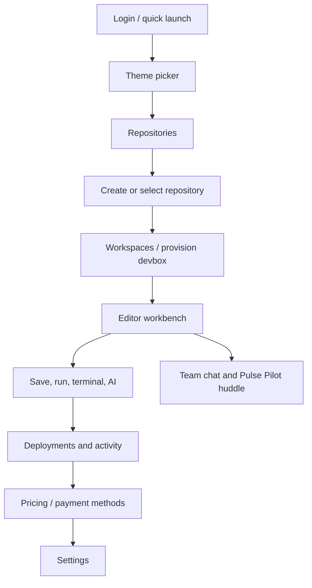
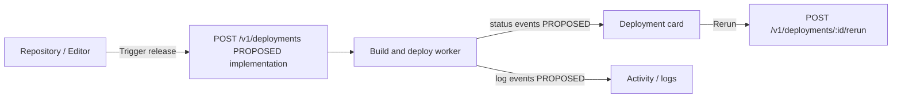
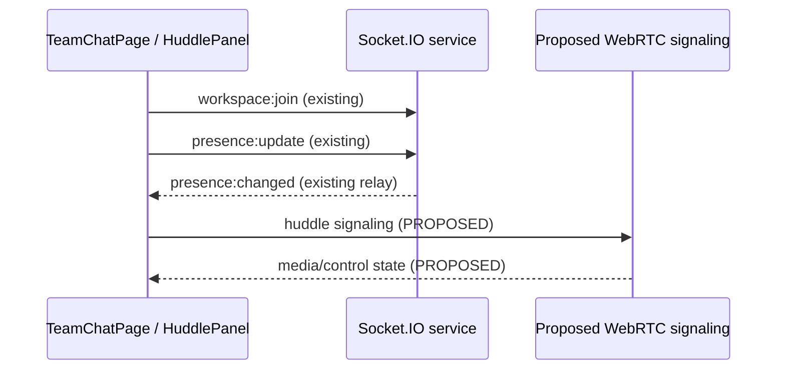

# Devpulse Backend Integration Contract

Source paths below are repo-root relative. `MOCK` means the current behavior is local, seeded, timed, or preview-only and does not constitute a durable backend operation. `PROPOSED` means the UI needs a server capability for a complete product flow; the route is not implemented unless explicitly listed under existing routes.

## 1. OVERVIEW

Devpulse is a developer workspace UI for projects, ephemeral development environments, code editing, deployment operations, AI assistance, and collaboration.
The browser client presents those capabilities as one navigable workspace with local preview data and selected service integrations.
The primary client is `apps/web`, built with Next.js 14 App Router, React 18, TypeScript, Tailwind CSS, Monaco, xterm, and Socket.IO client dependency.
Backend processes are separate Express services for API and AI plus a Socket.IO server; shared packages provide Prisma/PostgreSQL, types, UI, utilities, and tool configuration.
The Expo app is currently a branded placeholder; the main user journey is web-only.

**Monorepo:** `apps/web`, `apps/api`, `apps/ai`, `apps/socket`, `apps/mobile`; `packages/config`, `packages/database`, `packages/types`, `packages/ui`, `packages/utils`. Workspace config is `pnpm-workspace.yaml`, orchestration is `turbo.json`.

**Run web:** Node 20.10+, pnpm 9.15+: `corepack enable`, `pnpm install`, `pnpm --filter @devpulse/web dev`; open `http://localhost:3000`. Full stack commands and Docker setup are in `DEVELOPMENT.md`.

**Environment variable names used/configured:** `NODE_ENV`, `PORT`, `APP_URL`, `API_URL`, `SOCKET_URL`, `AI_URL`, `NEXT_PUBLIC_API_URL`, `NEXT_PUBLIC_SOCKET_URL`, `NEXT_PUBLIC_AI_URL`, `NEXT_PUBLIC_APP_URL`, `EXPO_PUBLIC_API_URL`, `EXPO_PUBLIC_SOCKET_URL`, `AI_PORT`, `SOCKET_PORT`, `DATABASE_URL`, `DIRECT_DATABASE_URL`, `REDIS_URL`, `ANTHROPIC_API_KEY`, `ANTHROPIC_MODEL`, `JWT_SECRET`, `JWT_REFRESH_SECRET`, `JWT_EXPIRES_IN`, `JWT_REFRESH_EXPIRES_IN`, `STRIPE_SECRET_KEY`, `STRIPE_WEBHOOK_SECRET`, `STRIPE_PUBLISHABLE_KEY`, `STRIPE_PRO_PRICE_ID`, `STRIPE_ENTERPRISE_PRICE_ID`, `AWS_ACCESS_KEY_ID`, `AWS_SECRET_ACCESS_KEY`, `AWS_REGION`, `AWS_S3_BUCKET`, `AWS_S3_ENDPOINT`, `AWS_S3_FORCE_PATH_STYLE`, `GOOGLE_CLIENT_ID`, `GOOGLE_CLIENT_SECRET`, `GITHUB_CLIENT_ID`, `GITHUB_CLIENT_SECRET`, `RESEND_API_KEY`, `EMAIL_FROM`, `S3_MINIO_ROOT_USER`, `S3_MINIO_ROOT_PASSWORD`, `POSTGRES_USER`, `POSTGRES_PASSWORD`, `POSTGRES_DB`.

## 2. USER FLOW

### Main journey



1. **Login:** OAuth provider buttons, email magic-link UI, Google, and instant/demo entry are shown. Local demo actions call `login()`; the OAuth/email path requires the auth routes in §6. Reads `UserProfile`; writes authenticated user/session. Current login is partly MOCK (see §9).
2. **Theme:** Choose and import a theme, customize primary colors, favorite/recent themes, and continue to workspaces/editor. Current writes are `localStorage`; backend preference sync is PROPOSED.
3. **Repositories:** Search name/description, filter all/starred/language, create, copy clone URL, star, delete, and launch a devbox. Existing client expects `/v1/repositories` list/create/patch/delete; fallback mutations are MOCK.
4. **Workspaces:** Create from template or Git URL, copy CLI instructions, start/stop/delete, open editor. Existing client expects `/v1/devboxes` list/create/patch/delete; state falls back to local mock. A server should return a devbox ID, lifecycle status, URL, and resource allocation.
5. **Deployments:** List release targets, trigger release, rerun pipeline, inspect logs and environment variables, and adjust deploy-on-push/ephemeral-PR controls. List/trigger/rerun/env calls are expected by context; status/log stream is absent and needs PROPOSED API + events.
6. **Editor:** Load a project or import a local file/folder; browse tree; edit, save, create/rename/delete files/folders; run, terminal, search, choose language, apply AI snippet. Project load, file CRUD, save, execution and terminal are MOCK/local except local File System Access API.
7. **AI:** Full-screen AI Studio sends a streamed conversation to `POST /v1/chat`; editor side panel currently uses a deterministic preview adapter. Generated diff application edits current browser contents only.
8. **Team chat + huddle:** Select channel, view messages, format/send, inspect channel details, start/join/leave Huddle, toggle mute/camera, screen share, grant/revoke editor control. Chat and Huddle are MOCK local state; socket backend only relays basic workspace presence.
9. **Pricing/billing:** Toggle monthly/annual, inspect plans, build custom plan, select a payment method, and open settings. UI-only; Stripe/customer/subscription/payment methods are PROPOSED.
10. **Settings:** Edit density/reduced motion/theme, select billing method, logout, remove device data, and access account/deletion affordances. Appearance and billing selection are device-local. Permanent account deletion is explicitly not connected.

### Release journey



### Collaboration journey



## 3. PAGE-BY-PAGE SPEC

### Page contracts

In this section, component basenames are under apps/web/app/components unless a full path is shown.

Loading/error/empty state terminology: context-wide initial data loading is `isDataLoading`; individual components provide skeletons or local empty states. The current API failures in initial resource loading are swallowed, and screens show seeded/local values. All writes marked MOCK below are not durable.

| Page id / display title / file | Reads and writes; visible actions and required server behavior | Loading, empty, error, MOCK location |
| --- | --- | --- |
| `login` / Welcome back / Sign in / `apps/web/app/components/LoginPage.tsx` | Reads `auth_error` query and email input. OAuth buttons GitHub/GitLab/SSO redirect to `/v1/auth/{provider}/start`; email requests `{email}` then verifies `{token}`; `/v1/me` session check in AppContext; logout `/v1/auth/logout`. Server must establish session cookie and safe profile. | Zod validates email (`Enter a valid work email address.`); API error or failed fetch appears as inline `authError`; loading flag during submit. DEV BYPASS and quick launch are MOCK; see §9. Google currently calls local `login()` directly. |
| `theme` / Choose Your App Look / Theme Library / `apps/web/app/components/ThemePalettePage.tsx` | Reads `ThemeConfig[]`, active theme, workspace count; choose theme, customize colors, continue, open editor/workspaces. Future preference endpoints store `themeId`, imported themes, favorite/recent IDs. | Theme library lazy-load/error handled in `ThemeMenu`; no server loading. VS Code JSON validation errors inline. Current persistence is localStorage. |
| `repositories` / Code Projects / `apps/web/app/components/RepositoriesPage.tsx` | Reads `Repository[]`, search, `repoFilter`, loading. Create sends `name`, `description`, `language`, `branch`; star sends `isStarred`; delete by repo ID; search/filter local; clone URL copy; launch calls devbox create. | Skeleton while `isDataLoading`; no matching cards state; create validation errors; action failures toast. Context catches API errors and performs MOCK fallback. |
| `workspaces` / Cloud Workspaces / `apps/web/app/components/WorkspacesPage.tsx` | Reads `WorkspaceDevbox[]`; create template or clone uses `name`, `template`, optional `repoUrl`, optional `specs`; toggle status; delete; continue to editor. Server needs async provisioning states and workspace authorization. | Skeleton while loading; empty list and quick guide; invalid blank clone URL toast; create/toggle/delete failures toast. Clone delay and fallback devbox data are MOCK in page/context. |
| `activity` / Your Activity / `apps/web/app/components/ActivityPage.tsx` | Reads `ActivityEvent[]`, `LogLine[]`, repositories/workspaces/deployments/user; local filters (`range`, category, project, query), pagination, export, details; start/pause/finish focus timer. Server should persist and page activity and timer events. | “No activity yet”/“No matching activity”; invalid timer storage logs console warning; API unavailable not surfaced because events are local. `devpulse_activity_timer` local, aggregation from MOCK logs/events. |
| `deployments` / Live Releases & Health / `apps/web/app/components/DeploymentsPage.tsx` | Reads deployments, logs, env vars, deploy-on-push/ephemeral-PR; trigger release with optional commit message; rerun by deployment ID; add/delete/reveal environment variables. Server owns secrets, redaction and deploy state. | Skeleton/context loading; empty deployments; env validation/storage errors and toast states. Release lifecycle and logs are MOCK fallback in AppContext; environment variables fall back locally. |
| `chat` / Team chat / `apps/web/app/components/TeamChatPage.tsx` | Page-local `ChatMessage[]`; active channel string; send formatted rich text, select channel, view details, create-channel/direct-message affordances, reactions/attachments UI, huddle entry. Server needs channels, members, messages, attachments/reactions, pagination/search. | Artificial 450ms `isChatLoading` then skeleton; no backend errors. All seed messages/local send are MOCK in this component. |
| `editor` / Maestro Code Studio / `apps/web/app/components/EditorWorkbench.tsx` | Reads editor session, file tree/content, open files, active ID, selected project/workspace; file/folder CRUD, rename, save, import, run, terminal, search, AI patch. Backend calls needed for project/tree/file operations, revision saves, execution and terminal. | Loading skeleton while editor loads; editor error string; empty “No workspaces yet”, “No files loaded”, “No files open”, no search matches. Save/permissions errors shown inline/toast. Starter project and local import are local; service adapters MOCK. |
| `remote-control` / Pulse Pilot / `apps/web/app/components/RemoteControlPage.tsx` | Reads local remote code and remote flags; controls session/access state. Current page selection is normalized to `chat`; required server counterpart is huddle/session signaling and permission changes. | No remote API loading/error model. Current controls/local remote content are MOCK. |
| `ai-studio` / AI Assistant / `apps/web/app/components/FullScreenAiPage.tsx` | Reads local messages, selected model, temperature, topP, input, user. Sends `messages: [{role,content}]` to AI service; consumes SSE `activity`, `token`, `done`, `error`; copy/apply code snippet. Server should validate identity/quota and return SSE. | `isGenerating`; errors from response JSON or invalid SSE content type (“AI service did not start a response stream.”); AI availability 503. Initial conversation is MOCK. Model preference is placed into prompt text; backend currently chooses `ANTHROPIC_MODEL`. |
| `pricing` / Plans & Billing / `apps/web/app/components/PricingPage.tsx` | Reads billing cycle; switch monthly/annual, select plan, go custom plan/payment methods, enterprise contact. Backend should return product/price IDs, checkout URL and subscriptions. | No data loading; static cards. Checkout/contact is MOCK alert/navigation. |
| `custom-plan` / Build your own plan / `apps/web/app/components/CustomPlanPage.tsx` | Local selected capacities/features and billing-cycle display; submit/configure custom plan should create quote/request. | Static UI, no API loading/error; request is MOCK. |
| `cloud-core` / Cloud Core Engine / `apps/web/app/components/CloudCoreDashboard.tsx` | Local allocation charts, date range, repo filters, contributor/session data; allocate resources/member controls. Server needs usage, capacity and allocation endpoints. | Static/local metrics; allocation dialog and update toasts are MOCK. |
| `api-sandbox` / API Sandbox / `apps/web/app/components/ApiSandboxPage.tsx` | Local scenario, method, endpoint, request headers/query/body/mock rules, response, synthetic records, snapshots. Execute, snapshot/restore, reset, add records, toggle record state. Server sandbox execution is optional product API; current endpoint uses `local://sandbox/v1/...`, never real API. | JSON parse/object validation errors inline/toast; local simulated response latency; empty record/search state. Entire engine/fixtures are MOCK in page. |
| `settings` / Site settings / `apps/web/app/components/SiteSettingsPage.tsx` | Reads user/theme, local UI prefs, local payment method; updates density/reduced motion/theme; reset preferences; logout; delete device data; account deletion dialog is unavailable. | Storage parse/load/save errors rendered; invalid billing method shows billing error; IndexedDB removal blocked/error shown. Settings and payment method remain device local. |
| `payment-methods` / Payment methods / `apps/web/app/components/PaymentMethodsPage.tsx` | Select card/PayPal/bank transfer and billing route; backend needs payment method setup/tokenization and customer association. | UI preview says no payment details are stored; selection persisted locally. No payment server call. |

### Shared shell and overlay/dialog contracts

| Component/file | Purpose, read/write, backend need, current behavior |
| --- | --- |
| `components/AppShell.tsx` | Global sidebar/topbar/mobile nav, route links, account and settings menus, command palette trigger, notifications, workspace/repository/release shortcut actions. Reads `user`, `page`, context actions. Page nav is client-only. Cluster health and notification feeds need service endpoints/events; current cluster status/action is local UI. UI density from `devpulse_ui_preferences`. |
| `components/CommandPalette.tsx` | Search/action list for navigation, theme and editor commands. Uses `setPage`, theme preview, editor actions; command catalog is client-only; no endpoint. |
| `components/OnboardingTour.tsx` | Three-step tour; completion/dismissal writes `devpulse_tour_done`; client-only. |
| `components/ShortcutsDialog.tsx` | Displays `EDITOR_SHORTCUTS`; client-only. |
| `components/RepositoryCreateDialog.tsx` | Collects repository name/description/language/private state and submits via RepositoriesPage. `isPrivate` is UI input but is not passed through current `addRepository()` context request; needs a visibility field if supported. |
| `components/ActivityDetailDialog.tsx` | Displays selected activity row; navigation callbacks to project/workspace/deployment pages; no direct API. |
| `components/ApiSnapshotDrawer.tsx` | Lists local API-sandbox snapshots and restores selected snapshot; all state local to ApiSandboxPage. |
| `components/CloudCoreAllocationDialog.tsx` | Collects allocation choices; parent owns local state; PROPOSED allocation endpoint. |
| `components/HuddlePanel.tsx` | Reads Huddle snapshot/participants; mute, camera, share, leave, grant/revoke control. Calls HuddleContext; currently service is local `huddle.ts`. |
| `components/FriendlyHelpers.tsx` | Event-backed alert/confirm UI and friendly hint; no backend. Confirm actions gate delete/reset operations. |
| `components/ToastContainer.tsx` | Renders context toast queue and removes timed/dismissed items; client-only. |
| `components/ThemeMenu.tsx` | Quick theme picker, favorites/recent, theme import/delete; themes and IDs are localStorage. VS Code conversion lives in `editor/vscodeThemeConverter.ts`. |
| `components/TerminalPanel.tsx` | xterm UI with terminal tabs, height/layout storage, resize and reconnect control. Keystrokes are echoed locally; commands explicitly are not executed. Must use a PTY transport (see §7). |
| `components/ShortcutsDialog.tsx`, `components/SkeletonLoaders.tsx`, `components/PageHeader.tsx`, `components/ide/Primitives.tsx` | Presentation-only shared components; no backend calls. |
| `components/ThemePalettePage.tsx` import dialog | Reads selected files and VS Code includes in browser; validation/import only; imported config writes localStorage. Backend theme sync is PROPOSED. |
| `components/SiteSettingsPage.tsx` data removal dialog | Clears browser `devpulse_*` data and IndexedDB handles, then logs out. This is device cleanup, not remote user deletion. Permanent deletion action says unavailable until account deletion is implemented. |
| `components/EditorWorkbench.tsx` overlays | Quick Open, breadcrumb menu, file search/replace, language/menu, tab context menu, save/conflict dialogs, AI drawer, editor settings/shortcuts/notifications, unsaved-close/changes dialogs. Local editor state only; file mutation/save dialogs must call project file APIs. |
| `components/TeamChatPage.tsx` channel details | Displays current channel metadata; no server data today; PROPOSED channel/member detail request. |
| `components/FullScreenAiPage.tsx` model menu | Model options are local choices; provider/model availability should be returned by a server capability endpoint. |

### Individual screen specifications

#### Login — login

Component apps/web/app/components/LoginPage.tsx. Reads email and auth_error query. Provider/email actions use the auth routes in §6 except Google and quick launch, which call local login(). Writes local UserProfile in AppContext. Invalid email and request errors are listed in §12.

#### Theme picker — theme

Component apps/web/app/components/ThemePalettePage.tsx. Reads active ThemeConfig, imported themes and workspace count. Select/preview, search/filter, color edits, mode switch, import VS Code JSON, continue. Writes theme and imported config locally; account preference sync is PROPOSED.

#### Repositories — repositories

Component apps/web/app/components/RepositoriesPage.tsx. Reads repositories, searchRepoQuery, repoFilter, isDataLoading. Create/delete/star via AppContext; search/filter are local; copy clone URL; launch calls spinUpDevbox. RepositoryCreateDialog collects name/description/language/private, but current addRepository request omits private.

#### Workspaces — workspaces

Component apps/web/app/components/WorkspacesPage.tsx. Reads workspaces/loading. Local template list: Next.js 15, FastAPI Python, Rust Axum, Go gRPC, PyTorch AI Agent. Create from template or Git URL, start/stop/delete, open editor, copy CLI instruction. API attempts plus MOCK fallback.

#### Activity — activity

Component apps/web/app/components/ActivityPage.tsx. Reads events/logs/repos/workspaces/deployments/user/loading. Local range today|7d|30d, category/project/search/page filters, show-all, details, export, focus timer start/pause/finish. Timer stored under devpulse_activity_timer; API persistence PROPOSED.

#### Deployments — deployments

Component apps/web/app/components/DeploymentsPage.tsx. Reads deployment cards, logs, envVars, deployOnPush, ephemeralPr. Trigger release, rerun, add/delete/reveal environment variables. Context executes timed MOCK pipeline when API calls fail.

#### Team chat — chat

Component apps/web/app/components/TeamChatPage.tsx. Reads user/theme/HuddleContext. activeChannel and messages are local. Select channel, send formatted rich text, create-channel/direct-message affordances, channel details, reactions/attachments UI, huddle entry. No chat API/socket call today.

#### Editor workbench — editor

Component apps/web/app/components/EditorWorkbench.tsx. Reads/writes editor session. Explorer tree, tabs, Monaco content, save, run, terminal, search/replace, language menu, local file/folder import, AI drawer. Managed project tree/content/run/save actions are local or MOCK today.

#### Pulse Pilot — remote-control

Component apps/web/app/components/RemoteControlPage.tsx. Legacy local pairing code/control flags; setPage maps remote-control to chat. Use huddle API/signaling for real collaboration; no server call.

#### AI Studio — ai-studio

Component apps/web/app/components/FullScreenAiPage.tsx. Reads local conversation, selectedModel, temperature, topP, user. Sends POST /v1/chat and parses SSE. Copy/apply code; patch application is local. Initial transcript is MOCK.

#### Pricing — pricing

Component apps/web/app/components/PricingPage.tsx. Reads billingCycle; plan cards and FAQ are local/static. Toggle month/year, select plan, navigate to payment methods/custom plan, enterprise CTA. Catalog/checkout PROPOSED.

#### Custom plan — custom-plan

Component apps/web/app/components/CustomPlanPage.tsx. Local plan selections and billing display. Custom quote/request action requires PROPOSED quote API; no current call.

#### Cloud Core — cloud-core

Component apps/web/app/components/CloudCoreDashboard.tsx. Local allocation/chart/range/repo/contributor/session state. CloudCoreAllocationDialog collects allocation/member data; capacity and allocation API PROPOSED.

#### API Sandbox — api-sandbox

Component apps/web/app/components/ApiSandboxPage.tsx. Scenario/request/response/records/snapshots held locally; executes local://sandbox/v1 simulation, not fetch to API. ApiSnapshotDrawer restores local snapshots; record detail is local.

#### Settings — settings

Component apps/web/app/components/SiteSettingsPage.tsx. Reads local profile/theme/UI/billing preference. Updates density/reduced motion/theme; Reset preferences resets to Dracula by contract and clears theme favorites/recents. Logout uses AppContext; device deletion clears localStorage/IndexedDB. Permanent account deletion unavailable.

#### Payment methods — payment-methods

Component apps/web/app/components/PaymentMethodsPage.tsx. Reads/writes card|paypal|bank-transfer selection under devpulse_billing_method; no credentials collected. Payment setup API PROPOSED.

### Individual overlay and dialog specifications

#### Account menu — AppShell.tsx

Reads user name/avatar/role; settings/profile/logout affordances. Logout invokes AppContext; profile editing is not implemented.

#### Settings & Theme menu — AppShell.tsx

Popover routes to settings or theme picker; local navigation and preview; no API.

#### Mobile navigation — AppShell.tsx

Overlay selects PageType; visibility is local state.

#### Command palette — CommandPalette.tsx

Local action catalog/search, navigation and editor commands; uses page/context actions, no backend search.

#### Keyboard shortcuts — ShortcutsDialog.tsx

Reads EDITOR_SHORTCUTS; display only.

#### Onboarding tour — OnboardingTour.tsx

Three-step local walkthrough; completion key devpulse_tour_done.

#### Repository creation — RepositoryCreateDialog.tsx

Name/description/language/private form; parent calls addRepository. Current request omits private. Server validates name, visibility and uniqueness.

#### Activity detail — ActivityDetailDialog.tsx

Displays selected event/log row and navigation actions; data supplied by ActivityPage.

#### API snapshot drawer — ApiSnapshotDrawer.tsx

Reads local snapshot list and restores request/response state; no API.

#### API record detail — ApiSandboxPage.tsx

Displays selected LedgerRecord; local selection/data only.

#### Cloud allocation — CloudCoreAllocationDialog.tsx

Collects allocation/member/project data; parent currently updates local arrays. Proposed POST /v1/cloud/allocations.

#### Channel detail — TeamChatPage.tsx

Displays selected channel metadata. Current values are local; proposed channel/member read.

#### Huddle control permission — HuddlePanel.tsx

Collects participant and editMode view-only|can-edit; calls huddle.grantControl. Current singleton only; proposed authenticated permission update.

#### AI model dropdown — FullScreenAiPage.tsx

Selected model is a local string; model list endpoint is PROPOSED.

#### Theme import — ThemePalettePage.tsx / ThemeMenu.tsx

Reads VS Code JSON/include files, validates and converts in browser, persists locally. Error messages come from file selection/validation; optional preference sync PROPOSED.

#### Editor Quick Open, breadcrumb, search/replace, language menus and tab context menu — EditorWorkbench.tsx

Reads local tree/tab/content; search results and selection are local. No backend until project tree/content is server-backed.

#### Editor AI assistant drawer — EditorWorkbench.tsx

Sends prompt/project/active path/code to deterministic preview adapter; apply appends snippet to active file. Replace with authenticated AI patch/stream and version checks.

#### Editor settings, shortcuts and notifications — EditorWorkbench.tsx

Editor preferences are local; notification panel is empty/preview. Optional settings sync; real notifications require event feed.

#### Unsaved close and changes — EditorWorkbench.tsx

Reads dirty state and offers save/discard/cancel. Save must await server acknowledgment and preserve drafts on network/version conflict.

#### Account/device data removal — SiteSettingsPage.tsx

Device removal clears IndexedDB/local state and logs out. Permanent deletion is unavailable; remote deletion needs re-authenticated API.

#### Alert/confirm host and toast queue — FriendlyHelpers.tsx / ToastContainer.tsx

Event-backed confirm/alert and timed AppContext toast queue are presentation only.

#### Terminal panel — TerminalPanel.tsx

xterm tabs/resize/reconnect controls. Current input is echoed locally and line submissions are explicitly not executed; PTY endpoints/events are PROPOSED.

## 4. DATA MODELS

Interfaces below preserve source names and fields. Required means non-optional in the current TypeScript declaration. Page-local interfaces are included where the product flow needs them. `ThemeConfig` references token interfaces in `apps/web/app/context/themeModel.ts`; token field sets are listed after the code.

```ts
// apps/web/app/context/AppContext.tsx
export interface UserProfile {
  name: string; email: string; handle: string; role: string;
  avatar: string; isAuthenticated: boolean;
}
export interface Repository {
  id: string; name: string; description: string; language: string;
  languageColor: string; stars: number; forks: number; branch: string;
  lastCommit: string; updatedAt: string; isStarred: boolean;
  deployStatus?: "live" | "building" | "none"; devboxReady?: boolean;
}
export interface WorkspaceDevbox {
  id: string; name: string; repo: string; branch: string; template: string;
  status: "Running" | "Stopped" | "Building"; uptime: string;
  vCpu: number; ram: string; storage: string; port: number; url: string;
}
export interface Deployment {
  id: string; target: string; domain: string;
  status: "Ready" | "Building" | "Failed"; branch: string;
  commitHash: string; commitMessage: string; author: string;
  timestamp: string; duration: string;
}
export interface ActivityEvent {
  id: string; timestamp: string; category: string; title: string;
  detail: string; project: string; actor: string; durationSeconds?: number;
}
export interface EnvVariable {
  id: string; key: string; value: string; scope: string;
  updatedAt: string; isRevealed?: boolean;
}
export interface Toast {
  id: string; type: "success" | "error" | "warning" | "info";
  title: string; description?: string; duration?: number;
}
export interface LogLine {
  id: string; time: string; timestamp?: string; tag: string;
  color: string; text: string;
}
export interface EditorFile {
  id: string; name: string; path: string; language: string;
  languageOverride?: boolean;
  iconType: "ts" | "js" | "py" | "json" | "yml" | "env" | "html" | "css" | "txt" | "folder";
  isDirty?: boolean; isDraft?: boolean;
}
```

```ts
// apps/web/app/context/themeModel.ts
export type ThemeType = "dark" | "light" | "hc";
export type ThemeGroup = "Default" | "Dark" | "Light" | "Custom";
export interface LegacyThemeFields {
  id: string; name: string; primary: string; secondary: string;
  tertiary: string; neutral: string; font: string; mode: string;
  roundness: string;
}
export interface ThemeConfig extends LegacyThemeFields {
  group: ThemeGroup; type: ThemeType; ui: ThemeUiTokens;
  syntax: ThemeSyntaxTokens; terminal: ThemeTerminalTokens;
  monaco?: ThemeMonacoTokens;
}
export interface ThemeSyntaxTokens {
  background: string; foreground: string; comment: string; keyword: string;
  string: string; number: string; cursor: string; selection: string;
}
export interface ThemeTerminalTokens {
  ansi: { black: string; red: string; green: string; yellow: string;
    blue: string; magenta: string; cyan: string; white: string;
    brightBlack: string; brightRed: string; brightGreen: string;
    brightYellow: string; brightBlue: string; brightMagenta: string;
    brightCyan: string; brightWhite: string; };
  fg: string; bg: string; cursor: string; selection: string;
}
export interface ThemeMonacoTokens {
  base: "vs" | "vs-dark" | "hc-black"; inherit: boolean;
  rules: Array<{ token: string; foreground?: string; background?: string; fontStyle?: string }>;
  colors: Record<string, string>;
}
```

`ThemeUiTokens` is `Record`-like but defined as required string fields in source. Fields are: `bg`, `panel`, `surface`, `elevated`, `border`, `border-strong`, `border-subtle`, `modal-border`, `text`, `text-strong`, `text-high`, `body-text`, `text-secondary`, `text-body`, `text-soft`, `text-dim`, `muted`, `subtle`, `accent`, `accent-hover`, `accent-fg`, `secondary-fg`, `accent-soft`, `surface-overlay`, `dropdown-bg`, `shell-bg`, `topbar-bg`, `sidebar-surface`, `app-content-bg`, `workbench-bg`, `welcome-action-bg`, `welcome-secondary-bg-start`, `welcome-secondary-bg-end`, `sidebar-footer-bg`, `terminal-border`, `editor-line-highlight`, `surface-raised`, `surface-hover`, `surface-hover-strong`, `skeleton-mid`, `skeleton-strong`, `secondary`, `accent-readable`, `secondary-readable`, `info-readable`, `success-readable`, `warning-readable`, `danger-readable`, `tertiary`, `warm-accent`, `danger`, `warning`, `success`, `info`, `hover`, `active`, `selection`, `focus-ring`, `scrollbar`, `scrollbar-hover`, `overlay`, `shadow-color`, `shadow-active`, `shadow-shortcut`, `shadow-panel`, `shadow-account`, `shadow-card`, `shadow-card-hover`, `shadow-strong`, `input-bg`, `input-border`, `tab-active`, `tab-inactive`, `statusbar-bg`, `statusbar-fg`, `sidebar-bg`, `editor-bg`, `gutter-fg`, `surface-card`, `surface-card-alt`, `surface-toolbar`, `surface-control`, `surface-control-hover`, `surface-empty`, `surface-danger`, `border-control`, `border-danger`, `text-tertiary`, `text-quiet`, `text-faint`, `text-placeholder`, `text-danger-soft`, `login-bg`, `login-panel`, `login-aside`, `login-code-bg`, `login-border`, `login-input-bg`, `login-input-border`, `login-muted`, `login-code-muted`, `login-code-keyword`, `login-code-string`, `login-code-number`, `login-border-soft`, `login-border-strong`, `login-text-subtle`, `login-text-secondary`, `login-code-comment`, `login-code-line`, `login-code-function`, `login-code-return`, `login-code-foreground`, `login-divider`, `login-accent-hover`, `login-error`, `repository-toolbar`, `repository-border`, `repository-focus`, `workspace-diagram-bg`, `workspace-surface`, `workspace-border`, `workspace-border-inner` (all `string`).

```ts
// apps/web/app/components/TeamChatPage.tsx (local interface)
interface ChatMessage {
  id: number; sender: string; role: string; roleColor: string; avatar: string;
  time: string; text: string; richTextHtml?: string; hasCode?: boolean;
  codeFilename?: string; codeSnippet?: string;
  attachment?: { name: string; size: string; sub: string };
  reactions?: { emoji: string; count: number }[];
}
// No ChatChannel interface exists; current active channel is a string ID.
// apps/web/app/services/huddle.ts
export interface HuddleParticipant { id: string; name: string; avatar: string; isYou?: boolean }
export interface HuddleSnapshot {
  active: boolean; startedAt: number | null; muted: boolean;
  cameraEnabled: boolean; sharingParticipantId: string | null;
  editingParticipantId: string | null; editMode: "view-only" | "can-edit";
}
// apps/web/app/components/BillingStorage.ts
export type PaymentMethod = "card" | "paypal" | "bank-transfer";
// packages/types/src/index.ts
export type Plan = "FREE" | "PRO" | "ENTERPRISE";
export type WorkspaceRole = "OWNER" | "ADMIN" | "MEMBER" | "GUEST";
export interface WorkspaceSummary { id: string; name: string; slug: string; plan: Plan }
export interface ApiError { code: string; message: string; requestId?: string }
```

Other editor shapes: `treeFiles: EditorFile[]`; `treeFolders: string[]` (folder paths); `openFiles: EditorFile[]` (same shape as tree file, with dirty/draft state); file contents and saved snapshots are `Record<string,string>` keyed by `EditorFile.id`. AppContext's internal `EditorSessionSnapshot` is `{isEditorProjectOpen:boolean, editorProjectId:string, loadedProjectName:string, treeFiles:EditorFile[], treeFolders:string[], openFiles:EditorFile[], activeFileId:string, fileContents:Record<string,string>, savedFileContents:Record<string,string>}`. `LogLine.color` is a UI class string in current seeded values, not a stable server semantic.

**Required/optional/enums/example:** Every field without `?` above is required; all optional fields are indicated by `?`. Literal unions are the allowed values for `status`, `ThemeType`, `ThemeGroup`, toast `type`, `editMode`, `Plan`, `WorkspaceRole`, and `PaymentMethod`. Example payloads appear in §14. String dates currently mix ISO timestamps with labels such as `12m ago`/`Just now`; backend contracts should standardize on ISO 8601 UTC and return a separate duration field.

**Relationships:** `Repository.id` identifies the project-like repo; `WorkspaceDevbox.repo` is currently a repo name string, not FK. `Deployment.target` currently identifies a deploy target and is used as the activity `project`; no repository ID exists on it. `ActivityEvent.project` is a display name string. `EditorFile.id` keys content maps; file path is project-relative. Proposed persisted model should add explicit `userId`, workspace/project IDs, repository-provider identity, `projectId` on devbox/deployment/file, `authorId` on chat and event, and `channelId` on message.

### Prisma entities and proposed persisted UI DTOs

The following field lists reflect packages/database/prisma/schema.prisma; relation objects are indicated separately.

| Prisma model / enum | Fields, requiredness and relationships |
| --- | --- |
| Plan | FREE, PRO, ENTERPRISE |
| WorkspaceRole | OWNER, ADMIN, MEMBER, GUEST |
| ChannelType | PUBLIC, PRIVATE, DIRECT |
| User | id String @id cuid; email String @unique; name String?; avatarUrl String?; passwordHash String?; memberships WorkspaceMember[]; ownedSpaces Workspace[]; messages Message[]; createdAt DateTime; updatedAt DateTime |
| Workspace | id String @id cuid; name String; slug String @unique; plan Plan default FREE; ownerId String FK User.id; owner User; memberships WorkspaceMember[]; projects Project[]; channels Channel[]; createdAt,updatedAt DateTime |
| WorkspaceMember | workspaceId String FK; userId String FK; role WorkspaceRole default MEMBER; workspace Workspace; user User; joinedAt DateTime; composite primary key (workspaceId,userId) |
| Project | id String @id cuid; workspaceId String FK Workspace.id; name String; defaultBranch String default main; workspace Workspace; files File[]; createdAt,updatedAt DateTime |
| File | id String @id cuid; projectId String FK Project.id; path String; content String default empty; language String?; version Int default 1; project Project; revisions FileRevision[]; updatedAt DateTime; unique(projectId,path) |
| FileRevision | id String @id cuid; fileId String FK File.id; version Int; content String; authorId String?; file File; createdAt DateTime; unique(fileId,version) |
| Channel | id String @id cuid; workspaceId String FK Workspace.id; name String; type ChannelType default PUBLIC; workspace Workspace; messages Message[]; createdAt DateTime |
| Message | id String @id cuid; channelId String FK Channel.id; authorId String FK User.id; body String; channel Channel; author User; createdAt DateTime; editedAt DateTime?; deletedAt DateTime? |

The Prisma schema has no Repository, WorkspaceDevbox, Deployment, EnvVariable, ActivityEvent, LogLine, terminal session, HuddleSession, billing method or subscription model. The UI Repository and devbox are independent shapes; a display-name field is not a foreign key.

These proposed UI/server DTOs have no matching persisted interface today:

~~~ts
interface TreeFolder { path: string }
type OpenFile = EditorFile;
interface ChatChannel {
  id: string; workspaceId: string; name: string;
  type: "PUBLIC" | "PRIVATE" | "DIRECT"; memberIds?: string[];
}
interface ChatMessageRecord {
  id: string; channelId: string; authorId: string; body: string;
  createdAt: string; editedAt?: string; deletedAt?: string;
}
interface HuddleSession {
  id: string; workspaceId: string; channelId?: string;
  active: boolean; startedAt: string; endedAt?: string;
  participants: HuddleParticipant[];
}
interface PlanDetail {
  id: Plan; name: string; priceId: string;
  billingCycle: "monthly" | "annual"; amount: number; currency: string;
}
interface PaymentMethodRecord {
  id: string; type: PaymentMethod; brand?: string;
  last4?: string; isDefault: boolean;
}
~~~

ChatChannel.type matches Prisma ChannelType. ChatMessageRecord uses durable IDs/author; current TeamChatPage ChatMessage is a presentation shape with numeric id/sender/role/avatar/time. HuddleSnapshot is the exact current local service shape; HuddleSession above is proposed persistence. PaymentMethod is the current UI union card|paypal|bank-transfer; no payment-record interface exists in code.

### Seed data (all MOCK)

| Data | Seed location and contents |
| --- | --- |
| User | `AppContext.tsx:getDefaultUser()`: Alex, `alex@devpulse.dev`, handle `alex`, role `Staff Platform Engineer`, Unsplash avatar; default authenticated unless `devpulse_logged_out=true`. |
| Repositories | `INITIAL_REPOSITORIES`: `devpulse-core` (TypeScript, 124 stars, 38 forks, staging, starred/live); `neural-coder-daemon` (Python, 89/14, main, starred/building); `wireguard-mesh-router` (Go, 45/9, v1.4-stable, unstarred/live); `microkernel-hypervisor` (Rust, 210/42, master, starred/none). |
| Deployments | `INITIAL_DEPLOYMENTS`: `dep-1` ready preview, `dep-2` ready production, `dep-3` building QA; all author `alex`. |
| Environment variables | `INITIAL_ENV_VARS`: four demo variables (`DATABASE_CLUSTER_URL`, `OPENAI_API_KEY`, `JWT_SECRET_KEY`, `VECTOR_EMBEDDING_MODEL`); values are preview data and must never be treated as real credentials. |
| Logs | `INITIAL_LOGS`: ten pipeline/git/build/network/health/success lines in `AppContext.tsx`. |
| Editor files | `DEFAULT_EDITOR_FILES` / `DEFAULT_FILE_CONTENTS`: `src/index.ts`, `src/server.ts`, `src/workers/agent.py`, `package.json`, `README.md` starter examples. |
| Chat | `TeamChatPage.tsx`: two seeded messages from Sarah Lin and Marcus Vance, including code and attachment metadata. |
| Huddle participants | `huddle.ts:HUDDLE_PARTICIPANTS`: `you` and `sarah`; MOCK identities. |
| Prisma | `packages/database/prisma/seed.ts`: upserts `demo@devpulse.local` and `demo` workspace. Does not seed repos/devboxes/deployments/chat. |
| API Sandbox | `ApiSandboxPage.tsx`: `INITIAL_RECORDS`, scenario bodies, synthetic ledger/session data and count values. MOCK. |

## 5. STATE MANAGEMENT MAP

Every globally exposed field/function below is declared in AppContextType in apps/web/app/context/AppContext.tsx. “Server-owned” means canonical durable state belongs on the server; “client-only” means ephemeral UI state; “hybrid” means local presentation backed by the server.

| Field/function | Current behavior / classification | Persistence and target |
| --- | --- | --- |
| page, setPage(page) | Selected route; maps remote-control to chat; client-only | devpulse_active_page |
| isClientStorageHydrated | Gates first render while browser data is restored; client-only | none |
| user, login(email?,name?), logout() | Demo profile/local auth; hybrid identity | devpulse_user_session, devpulse_logged_out; canonical user/session server-owned |
| theme, setTheme(theme) | Applies/resolves theme; hybrid | devpulse_theme, devpulse_theme_selected; optional account preference sync |
| importedThemes, addImportedTheme(theme), deleteImportedTheme(id) | Imported theme configs; hybrid | devpulse_imported_themes |
| colorMode, matchSystemTheme | colorMode derives from theme.type; provider returns matchSystemTheme false; stored mode/system keys are read but not used in active context | devpulse_color_mode, devpulse_match_system_theme |
| availableThemes | Returns THEME_PRESETS; built-in catalog is client code | none |
| commandPaletteQuery, setCommandPaletteQuery(query) | Palette search; client-only | none |
| repositories, searchRepoQuery, setSearchRepoQuery(query), repoFilter, setRepoFilter(filter) | Repo collection + local search/filter; hybrid data | repository server-owned; no storage key |
| addRepository(repo), deleteRepository(id), toggleStarRepo(id) | Calls API then local fallback; hybrid | implement /v1/repositories |
| workspaces, spinUpDevbox(name,template,repoUrl?,specs?), toggleWorkspaceStatus(id), deleteWorkspace(id) | Calls API then local fallback; hybrid | devpulse_workspaces; devbox server-owned |
| deployments, triggerNewRelease(customMessage?), rerunPipeline(id?) | Calls API then local fallback/timed fake pipeline; hybrid | server-owned |
| activityEvents, addActivityEvent(event) | Builds local actor/id/timestamp event, capped at 500 | devpulse_activity_events; server-owned audit history |
| isDataLoading | Initial API load status; client-only | none |
| envVars, addEnvVar(key,value,scope), deleteEnvVar(id) | API attempt then local fallback; hybrid; values currently exposed in client | no key; secret data server-owned/redacted |
| toggleRevealEnvVar(id), revealAllEnvVars, toggleRevealAllEnvVars() | Revealed state in memory; client-only | none |
| deployOnPush, setDeployOnPush, ephemeralPr, setEphemeralPr | Deployment options; client state | no current persistence; server preference |
| logs, clearLogs(), addLog(tag,color,text) | In-memory log buffer and pipeline preview | no key; server-streamed logs should become canonical |
| isCommandPaletteOpen, setIsCommandPaletteOpen(open), isShortcutsDialogOpen, setIsShortcutsDialogOpen(open) | Overlay state; client-only | none |
| isEditorProjectOpen, setIsEditorProjectOpen(open), closeEditorProject(), editorProjectId, isEditorLoading, editorError, loadEditorProject() | Project/editor session; loader creates local starter data | devpulse_editor_session; managed project server-owned |
| loadedProjectName, setLoadedProjectName(name), treeFiles, treeFolders, createNewFolder(path) | Editor tree and label; folder entries are path strings | editor session; managed tree server-owned |
| openFiles, activeFileId, setActiveFileId(id), openFileInEditor(file), closeFileFromEditor(id), reorderOpenFiles(from,to), closeOtherFilesFromEditor(id), closeAllFilesFromEditor() | Open tabs/current tab; UI session | devpulse_editor_session |
| updateEditorFileLanguage(id,language,languageOverride?), updateFileContent(id,content), setEditorFileDraft(id,isDraft), fileContents, savedFileContents, saveFileContent(id) | Buffer/dirtiness; save uses preview adapter | devpulse_editor_session; content/revisions server-owned for managed workspaces |
| renameEditorFile(id,nextName,isDraft?), createNewFile(name,path?,initialContent?,isDraft?), deleteFile(id) | Local tree operations | session key; managed files server-owned |
| loadUserLocalFiles(folderName,files), loadSingleLocalFile(name,content) | User-selected browser files/folder | local document remains local unless user imports/uploads |
| isFileTreeOpen, setIsFileTreeOpen, isAiDrawerOpen, setIsAiDrawerOpen, isTerminalOpen, setIsTerminalOpen | Editor panel visibility | devpulse-editor-panels |
| isTerminalFocused, setIsTerminalFocused(focused) | Focus state | client-only |
| applyDiffToActiveFile(snippet) | Appends snippet text to active buffer; MOCK application | editor session; server-side patch should be validated |
| remoteCode, updateRemoteCode(code), isRemoteControlling/setIsRemoteControlling, isRemoteMuted/setIsRemoteMuted, isRemoteCameraOn/setIsRemoteCameraOn | Legacy remote-control UI state | no key; MOCK, replaced by huddle state |
| billingCycle, setBillingCycle(cycle) | monthly/annual display selector | no key; client until checkout |
| toasts, addToast(toast), removeToast(id) | Timed UI notification queue | client-only |
| isTourActive, tourStep, nextTourStep(), prevTourStep(), dismissTour() | Three-step onboarding | devpulse_tour_done |

### Browser persistence key inventory

| Store/key | Value shape / owner |
| --- | --- |
| localStorage devpulse_active_page | PageType string; route preference |
| localStorage devpulse_user_session | JSON UserProfile; demo/local identity |
| localStorage devpulse_logged_out | string true; local logout override |
| localStorage devpulse_theme | JSON resolved ThemeConfig; default/fallback is Dracula by this contract |
| localStorage devpulse_imported_themes | ThemeConfig[] |
| localStorage devpulse_theme_selected | string true; onboarding marker |
| localStorage devpulse_color_mode | dark or light string; currently read, not used as context mode |
| localStorage devpulse_match_system_theme | boolean string; currently read, exposed value remains false |
| localStorage devpulse_workspaces | JSON WorkspaceDevbox[] local fallback |
| localStorage devpulse_activity_events | JSON ActivityEvent[] capped to 500 |
| localStorage devpulse_editor_session | EditorSessionSnapshot: project flags/ids/name, treeFiles, treeFolders, openFiles, activeFileId, fileContents, savedFileContents |
| localStorage devpulse-editor-panels | {explorerOpen:boolean,aiOpen:boolean,terminalOpen:boolean} |
| localStorage devpulse-ide-layout | JSON {aiPanelWidth:number,explorerWidth:number,editorSettings:object,pinnedTabs:string[]} |
| localStorage devpulse-editor-hint-dismissed | string true |
| localStorage devpulse-workbench-sidebar-open | string boolean |
| localStorage devpulse-terminal-layout | {tabs:{id:number,title:string}[],activeTabId:number,height:number} |
| localStorage devpulse_activity_timer | {elapsedSeconds:number,startedAt:string|null} |
| localStorage devpulse_ui_preferences | {density:"comfortable"|"compact",reduceMotion:boolean} |
| localStorage devpulse_billing_method | card, paypal, or bank-transfer; selection only, not card credentials |
| localStorage devpulse_theme_favorites | JSON string[] theme ids |
| localStorage devpulse_recent_themes | JSON string[] theme ids |
| localStorage devpulse_tour_done | string true |
| IndexedDB devpulse-editor-handles / object store handles / key active-workspace | structured clone of {kind:"file"|"directory",handle:FileSystemFileHandle|FileSystemDirectoryHandle} |
| sessionStorage devpulse_* | No writer found in app source; Settings clears prefixed keys |

Settings removes localStorage keys beginning devpulse_ except devpulse_logged_out and devpulse_active_page; also deletes the IndexedDB database and prefixed sessionStorage keys.

## 6. API CONTRACT (WHAT THE FRONTEND EXPECTS)

### Implemented routes and events

| Method/path or event | File:line | Current contract |
| --- | --- | --- |
| GET /health | apps/api/src/index.ts:27; apps/ai/src/index.ts:13; apps/socket/src/index.ts:9 | {status:"ok",service:"api"|"ai"|"socket"} |
| GET /ready | apps/api/src/index.ts:30 | {status:"ready"} |
| POST /v1/chat | apps/ai/src/index.ts:16 | Reads request.body.messages; without ANTHROPIC_API_KEY returns 503 {error:"AI provider is not configured"}; otherwise SSE activity/token/done/error events |
| Socket.IO workspace:join(workspaceId), workspace:leave(workspaceId), presence:update({workspaceId,status}) | apps/socket/src/index.ts:13-16 | Join/leave workspace room; relays presence:changed to room peers; no auth/ack/validation |

apps/api/src/index.ts contains no /v1/* handler. All /v1 paths below are frontend expectations with PROPOSED backend implementation unless described as implemented above.

### Conventions

- API base is NEXT_PUBLIC_API_URL or http://localhost:4000; AI base is NEXT_PUBLIC_AI_URL or http://localhost:4002. NEXT_PUBLIC_SOCKET_URL exists in env/compose but no web io() connection is currently present.
- apiJson() sets Content-Type: application/json but no credentials:"include" or Authorization header. /v1/me, logout and magic-link fetches explicitly set credentials:"include". AI request has no auth header or credentials.
- PROPOSED browser auth: HttpOnly; Secure; SameSite=Lax cookie; native clients use short-lived Bearer access token; never store tokens in localStorage. Enforce workspace membership/role per request.
- PROPOSED list convention: cursor + limit (default 50, max 100), q and filters; response {items,nextCursor}. Existing client expects unpaged {repositories}, {devboxes}, {deployments}, {variables}.
- apiJson error parsing expects top-level {error:string}, else synthesizes “Request failed with status N”. packages/types defines ApiError {code,message,requestId?}; no API middleware currently emits it. Choose one consistent shape; compatibility may return both.
- PROPOSED IDs are stable opaque strings (Prisma cuid compatible). Standardize timestamps as ISO 8601 UTC. Existing UI fixtures contain relative strings and chat IDs are numbers.

### Endpoint matrix

| Method/path | Auth | Request | Success response | Error | Caller / implementation |
| --- | --- | --- | --- | --- | --- |
| GET /v1/me | session | none | {email,name?,avatarUrl?} | {error:string} | AppContext.tsx:1365; called, server PROPOSED |
| POST /v1/auth/{github\|gitlab\|sso}/start | anonymous | redirect; SSO tenant/provider config | 302 OAuth redirect | redirect login?auth_error= | LoginPage.tsx:70; redirect called, handler PROPOSED |
| GET /v1/auth/:provider/callback | anonymous | code,state | 302 + session cookie | auth_error redirect | PROPOSED |
| POST /v1/auth/google/start and callback | anonymous | OAuth state/code | 302/session cookie | auth_error redirect | PROPOSED; Google currently bypasses |
| POST /v1/auth/magic-link | anonymous | {email:string} | {verificationToken?:string} in current dev UI; production should send email without disclosing token | {error:string} | LoginPage.tsx:85; called, server PROPOSED |
| POST /v1/auth/magic-link/verify | anonymous | {token:string} | {user:{email,name?}} + cookie | {error:string} | LoginPage.tsx:101; called, server PROPOSED |
| POST /v1/auth/logout | session | {} | 204 or {ok:true}, clear cookie | standard error | AppContext.tsx:1434; called, server PROPOSED |
| GET/PATCH /v1/users/me | session | PATCH {name?,handle?,avatar?} | user profile {id,email,name,handle,role,avatar} | standard error | PROPOSED profile editor |
| GET /v1/repositories | session | q?,language?,starred?,cursor?,limit?; current no query | {repositories:Repository[]} | top-level {error:string} | AppContext.tsx:1945; called, server PROPOSED |
| POST /v1/repositories | session | {name,description,language,branch}; private not currently forwarded | repo incl id,name,description,language,stars,forks,isStarred,defaultBranch,deployStatus,devboxReady,updatedAt | validation/standard error | AppContext.tsx:1472; called, server PROPOSED |
| PATCH /v1/repositories/:id | session | {isStarred:boolean} | updated repo/star state | 404/standard error | AppContext.tsx:1543; called, server PROPOSED |
| DELETE /v1/repositories/:id | session | none | 204 | 404/standard error | AppContext.tsx:1526; called, server PROPOSED |
| GET /v1/devboxes | session | status?,projectId?,cursor?,limit? | {devboxes:WorkspaceDevbox[]} | standard error | AppContext.tsx:1946; called, server PROPOSED |
| POST /v1/devboxes | session | {name,template,repo,vCpu,ram,storage}; repo derived from clone URL basename | WorkspaceDevbox | quota/validation error | AppContext.tsx:1577; called, server PROPOSED |
| GET /v1/devboxes/:id | session | none | WorkspaceDevbox | 404 | PROPOSED status refresh |
| PATCH /v1/devboxes/:id | session | {status:"Running"|"Stopped"} | updated WorkspaceDevbox | invalid transition | AppContext.tsx:1630; called, server PROPOSED |
| DELETE /v1/devboxes/:id | session | none | 204 | 404 | AppContext.tsx:1659; called, server PROPOSED |
| GET /v1/deployments | session | repoId?,status?,cursor?,limit? | {deployments:Deployment[]} | standard error | AppContext.tsx:1947; called, server PROPOSED |
| POST /v1/deployments | session | {commitMessage?:string,author:string}; proposed add repositoryId,branch,devboxId | Deployment | validation/quota | AppContext.tsx:1693; called, server PROPOSED |
| POST /v1/deployments/:id/rerun | session | none | {deployment:Deployment} or accepted job | 404/standard error | AppContext.tsx:1794; called, server PROPOSED |
| GET /v1/deployments/:id/logs | session | cursor?,limit? or stream | {items:LogLine[],nextCursor} | 404 | PROPOSED; Deployment page |
| GET /v1/environment-variables | session | projectId?,scope? | {variables:EnvVariable[]} | standard error | AppContext.tsx:1948; called, server PROPOSED |
| POST /v1/environment-variables | session + secret-write | {key,value,scope} | EnvVariable; redact value on list | validation/duplicate | AppContext.tsx:1821; called, server PROPOSED |
| DELETE /v1/environment-variables/:id | session + secret-write | none | 204 | 404 | AppContext.tsx:1856; called, server PROPOSED |
| GET /v1/projects/:projectId/files | session | path?,cursor? | {files:TreeFile[],folders:TreeFolder[]} | 404 | PROPOSED tree load |
| GET /v1/projects/:projectId/files/:fileId | session | version? | {id,path,language,content,version,updatedAt} | 404 | PROPOSED read |
| POST /v1/projects/:projectId/files | session | {path,content?,language?} | created file incl id/version | duplicate/invalid path | PROPOSED create |
| POST /v1/projects/:projectId/folders | session | {path} | {path} | duplicate/invalid path | PROPOSED create folder |
| PATCH /v1/projects/:projectId/files/:fileId | session | {path?,content?,language?,expectedVersion:number} | {id,path,version,updatedAt} | 409 VERSION_CONFLICT + latestVersion | PROPOSED save/rename |
| DELETE /v1/projects/:projectId/files/:fileId | session | none | 204 | 404 | PROPOSED delete |
| GET/PUT /v1/projects/:projectId/editor-session | session | PUT {openFileIds,activeFileId,layout} | session JSON | standard error | PROPOSED |
| POST /v1/devboxes/:id/run | session | {path,language,code} | {ok:boolean,exitCode:number,output:string} | timeout/quota/rejected | PROPOSED runEditorPreview replacement |
| POST /v1/devboxes/:id/terminal-sessions | session | {cols,rows,workingDirectory?} | {terminalId,websocketUrl} | stopped/forbidden | PROPOSED PTY create |
| DELETE /v1/terminal-sessions/:terminalId | session | none | 204 | standard error | PROPOSED PTY close |
| GET /v1/activity | session | cursor,limit,from,to,category,projectId,q | {items:ActivityEvent[],nextCursor} | standard error | PROPOSED ActivityPage |
| POST /v1/activity/events | session | {category,title,detail,projectId?,durationSeconds?} | ActivityEvent | validation | PROPOSED audit event |
| POST /v1/focus-sessions | session | {startedAt} | {id,startedAt} | standard error | PROPOSED timer start |
| PATCH /v1/focus-sessions/:id | session | {endedAt,elapsedSeconds} | completed event | invalid transition | PROPOSED pause/finish |
| GET /v1/ai/models | session | none | {models:[{id,label,capabilities}]} | standard error | PROPOSED model picker |
| POST /v1/ai/chat | session + quota | {messages:[{role:"user"|"assistant",content}],model?,temperature?,topP?,projectId?,fileId?} | SSE activity/token/done/error | JSON error before stream | PROPOSED proxy; current AI route is POST /v1/chat |
| POST /v1/ai/diffs | session + file-write | {projectId,fileId,baseVersion,patch} | {patchId,preview,accepted} | conflict/invalid patch | PROPOSED structured patch; apply currently local |
| POST /v1/ai/completions | session + quota | {language,linePrefix,projectId?,fileId?} | {insertText:string} or 204 | rate limit | PROPOSED inline completion |
| POST /v1/language/completions | session | {language:"python"|"java"|"go"|"cpp",prefix} | {items:LanguageCompletion[]} | standard error | PROPOSED language server |
| GET/POST /v1/chat/channels | session | GET workspaceId,cursor,limit; POST {workspaceId,name,type,memberIds?} | {channels:ChatChannel[]} / ChatChannel | permission/validation | PROPOSED |
| GET/POST /v1/chat/channels/:channelId/messages | member | GET cursor,limit,before; POST {body,richTextHtml?,attachmentIds?} | {messages,nextCursor} / ChatMessage | 403/validation | PROPOSED |
| PATCH/DELETE /v1/chat/messages/:messageId | author/moderator | PATCH {body}; DELETE none | updated message / 204 soft delete | 403/404 | PROPOSED |
| PUT /v1/chat/messages/:messageId/reactions/:emoji | member | none | {emoji,count,reacted} | standard error | PROPOSED |
| GET /v1/chat/members | member | workspaceId,channelId? | {members:[Participant]} | standard error | PROPOSED |
| GET /v1/chat/search | member | q,channelId?,cursor? | {messages,nextCursor} | standard error | PROPOSED |
| POST /v1/huddles | session + workspace member | {workspaceId,channelId?} | HuddleSession + signaling token | permission/limit | PROPOSED |
| POST /v1/huddles/:id/leave | participant | none | {ok:true} | 404 | PROPOSED |
| PATCH /v1/huddles/:id/permissions | control grant | {participantId,editMode:"view-only"|"can-edit"} | permission state | 403/404 | PROPOSED |
| GET /v1/plans | public/session | none | {plans:[PlanDetail]} | standard error | PROPOSED |
| POST /v1/billing/checkout | session | {priceId,billingCycle:"monthly"|"annual",successUrl,cancelUrl} | {checkoutUrl} | provider error | PROPOSED |
| GET /v1/billing/subscription | session | none | subscription summary or {subscription:null} | standard error | PROPOSED |
| GET /v1/billing/payment-methods | session | none | {paymentMethods:[PaymentMethodRecord]} | standard error | PROPOSED |
| POST /v1/billing/setup-intent | session | {method:"card"|"paypal"|"bank-transfer"} | {clientSecret?,redirectUrl?} | provider error | PROPOSED |
| DELETE /v1/billing/payment-methods/:id | session | none | 204 | provider error | PROPOSED |
| GET/PUT /v1/users/me/preferences | session | PUT {themeId,importedThemes,favorites,recent,density,reduceMotion,colorMode,matchSystemTheme} | preference object | validation | PROPOSED |
| DELETE /v1/users/me | session + re-auth | {confirmation} | 202 {deletionScheduledAt} | re-auth/policy error | PROPOSED; current UI says unavailable |
| POST /v1/cloud/allocations | workspace admin | {memberName,projectIds,cpu?,memory?} | allocation record | capacity/permission | PROPOSED |
| POST /v1/sandbox/execute | session + quota | {scenario,method,endpoint,headers,queryParams,body,mockRules} | {statusCode,headers,body,latency,traceId} | validation/timeout | PROPOSED; current UI uses local:// |

## 7. REAL-TIME AND STREAMING EVENTS

| Channel/event | Direction | Payload | Consumer/source |
| --- | --- | --- | --- |
| SSE /v1/chat activity | server→client | {type:"activity",phase:"thinking"|"searching"|"terminal"|"writing",detail:string} | FullScreenAiPage.tsx |
| SSE /v1/chat token | server→client | {type:"token",text:string} | FullScreenAiPage accumulates |
| SSE /v1/chat done | server→client | {type:"done"} | FullScreenAiPage |
| SSE /v1/chat error | server→client | {type:"error",error:string} | FullScreenAiPage |
| workspace:join | client→server | workspaceId:string | implemented Socket server; no web consumer |
| workspace:leave | client→server | workspaceId:string | implemented server; no web consumer |
| presence:update | client→server | {workspaceId,status} | implemented server |
| presence:changed | server→client | relayed {workspaceId,status} | implemented server; no subscriber |
| terminal:{id}:input | client→server | {data:string,sequence:number} | PROPOSED; TerminalPanel currently echoes |
| terminal:{id}:output | server→client | {data:string,sequence:number} | PROPOSED PTY output |
| terminal:{id}:resize | client→server | {cols:number,rows:number} | PROPOSED xterm resize |
| terminal:{id}:exit | server→client | {exitCode:number,signal?:string} | PROPOSED |
| deployment:{id}:status | server→client | {id,status:"Building"|"Ready"|"Failed",timestamp,duration?} | PROPOSED Deployment page/AppContext |
| deployment:{id}:log | server→client | LogLine | PROPOSED Deployment/Activity |
| devbox:{id}:status | server→client | {id,status:"Building"|"Running"|"Stopped",url?,uptime?} | PROPOSED WorkspacesPage |
| chat:channel:{id}:message | both | ChatMessage, persisted id/ack | PROPOSED TeamChatPage |
| chat:channel:{id}:typing | both | {channelId,userId,typing:boolean} | PROPOSED |
| chat:channel:{id}:reaction | both | {messageId,emoji,count,actorId} | PROPOSED |
| huddle:join / huddle:leave | both | {sessionId,participant:Participant} | PROPOSED HuddleContext |
| huddle:mute / huddle:camera | both | {sessionId,muted:boolean,cameraEnabled:boolean} | PROPOSED huddle.ts controls |
| huddle:screen-share:start / :stop | both | {sessionId,participantId,shareId?} | PROPOSED WebRTC signaling |
| huddle:grant-control / :revoke-control | both | {sessionId,participantId,editMode:"view-only"|"can-edit"} | PROPOSED huddle.ts |
| huddle:signal | both | {sessionId,fromParticipantId,toParticipantId,description?,candidate?} | PROPOSED SDP/ICE |
| editor:{projectId}:operation | both | {opId,actorId,fileId,baseVersion,range,text,version} | PROPOSED EditorWorkbench |
| notifications:user:{id} | server→client | {id,type,title,description?,createdAt,readAt?} | PROPOSED AppShell/ToastContainer |

huddle.ts exports HuddleService, HuddleSnapshot and a process-local singleton. start/leave/toggle methods only mutate that singleton. Camera/mic do not access devices; share sets an ID; grant-control does not synchronize editor edits. Replace with authenticated session API + signaling/WebRTC adapter. Terminal/log/deployment/workspace/chat/notification streams are not consumed by web today. socket.io-client is a dependency but no io() call exists in apps/web.

## 8. SERVICE LAYER / WHERE TO PLUG IN

In the table, services/* expands to apps/web/app/services/* and editor/* expands to apps/web/app/editor/*. For example, services/editorMocks.ts is apps/web/app/services/editorMocks.ts.

| Module/export | Signature and current return | Replacement |
| --- | --- | --- |
| services/editorMocks.ts runEditorPreview | (request:EditorRunRequest {path,language,code}):Promise<EditorRunResult {ok,exitCode,output}>; waits 450ms, returns ok true and preview text. MOCK. | Authenticated isolated runner; same result contract. |
| services/editorMocks.ts sendAssistantPreview | (request:AssistantRequest {prompt,projectName,activePath,code}):Promise<AssistantReply {text,code?}>; waits 700ms, deterministic preview. MOCK. | AI chat service. |
| services/editorMocks.ts saveEditorPreview | (request:SaveEditorPreviewRequest {path,content}):Promise<{saved:true}>; waits 160ms and always succeeds. MOCK. | Versioned project file save/conflict contract. |
| services/editorMocks.ts reconnectTerminalPreview | ():Promise<TerminalReconnectResult {connected,message}>; waits 500ms and returns disconnected. MOCK. | PTY session creation/reconnect, stream transport. |
| services/aiCompletion.ts getAIInlineCompletion | ({language,linePrefix}:AICompletionRequest):Promise<AICompletion {insertText}|null>; returns null unless // ai: or # ai: marker, else fixed “AI completion preview”. MOCK. | Completion endpoint with cancellation. |
| services/languageServer.ts getLanguageServerCompletions | ({language,prefix}:LanguageCompletionRequest):Promise<LanguageCompletion[]>; filters hardcoded Python/Java/Go/C++ labels. MOCK_COMPLETIONS. | LSP/completion service retaining label/insertText/detail. |
| services/huddle.ts huddleService | HuddleService methods startHuddle,leaveHuddle,toggleMute,toggleCamera,startScreenShare,stopScreenShare,grantControl,revokeControl,onEvent,getSnapshot; in-memory singleton state. MOCK. | Session API, Socket.IO signaling and WebRTC. |
| services/huddle.ts HUDDLE_PARTICIPANTS | Static You/Sarah Lin. MOCK. | Server channel/session participants. |
| editor/vscodeThemeConverter.ts convertVscodeThemeJson / convertVscodeThemeToAppTheme | Converts local VS Code JSON to ThemeConfig/Monaco rules. Not a backend mock. | Keep client-side; sync resulting config if desired. |
| editor/vscodeThemeConverter.ts registerVscodeTheme | Registers theme in Monaco; UI function. | Keep client-side. |
| editor/snippets.ts getSnippetsForLanguage | Returns static language snippets. | Client-only. |
| editor/shortcuts.ts EDITOR_SHORTCUTS/matchesShortcut/isTypingTarget | Static shortcut registry/matcher. | Client-only. |
| services/README.md | Lists the four editorMocks replacement seams. | Same adapter boundaries. |

Existing calls: LoginPage.tsx:70 OAuth redirect; LoginPage.tsx:85 magic-link; LoginPage.tsx:101 verify; AppContext.tsx:1365 /v1/me; AppContext.tsx:1434 logout; AppContext.tsx:1913 generic apiJson fetch; FullScreenAiPage.tsx:159 POST AI /v1/chat. apps/socket/src/index.ts:13-16 accepts socket events. No axios calls or web socket.io client initialization were found.

Replacement checklist: (1) auth and user session; (2) repository CRUD; (3) devbox lifecycle; (4) project tree/file revision APIs; (5) runner and PTY; (6) AI assistant/patch/completion; (7) language service; (8) chat, presence, Huddle/WebRTC; (9) deployment/activity/env secret streaming; (10) plans/billing/preferences. Remove local-success fallbacks only after corresponding endpoints are live.

## 9. AUTH AND SECURITY

- LoginPage has an explicit development bypass for GitHub/GitLab/SSO when NODE_ENV is development. It calls login() with synthetic dev-provider@localhost.dev and skips redirect. There is no separate bypass flag; production NODE_ENV takes the OAuth redirect branch.
- Google always calls local login("dev-github@localhost.dev","Alex"); it does not use an OAuth endpoint. The fallback/quick login branch uses local login(email || "alex@devpulse.dev","Alex").
- login() stores UserProfile in devpulse_user_session and clears devpulse_logged_out. Startup reads cached profile unless logged-out key is true. No JWT is read/stored by web client.
- /v1/me, logout, and magic-link calls include credentials. Generic AppContext apiJson and AI fetch do not. Cross-origin cookie auth requires credentials and matching CORS.
- API CORS allowlist is APP_URL (comma-separated) or http://localhost:3000 with credentials enabled. AI uses cors() unrestricted; Socket.IO uses APP_URL. Neither AI nor socket source has auth middleware.
- Require auth for user-owned repos, devboxes, files, deployments, env vars, activity, editor sessions, chat, huddles, AI quota, billing, preferences and account deletion. Auth initiation/callback, magic-link request, and plan catalog may be anonymous. Validate workspace role at each resource access.
- Treat server identity, actor, author, project/workspace IDs, status and secret visibility as server-derived; do not trust client request fields. Environment variable fixtures in AppContext are frontend-visible demo data, not secrets.
- AI /v1/chat currently accepts raw request.body.messages, has no schema, identity, quota, auth, or cancellation handling. Add payload size limits, schema validation, rate limiting, user authorization, provider error redaction, and disconnect cancellation.

## 10. FILE SYSTEM AND EDITOR

Managed editor starter data is local. AppContext loadEditorProject() selects editorProjectId "local-workspace", loads DEFAULT_EDITOR_FILES/DEFAULT_FILE_CONTENTS, and opens two tabs. Editor session persists in devpulse_editor_session. saveFileContent() calls saveEditorPreview({path,content}); that adapter waits and always returns {saved:true}, after which the client marks the content clean.

For managed Devpulse projects, project metadata, file tree, content, version/revisions and ACL must be server-owned. Tabs, active file, panel layout, search state and split layout can remain client-only. Browser-picked local files/folders can remain local unless the user explicitly imports/uploads them. EditorWorkbench uses the File System Access API, asks for write permission, reads text files, and stores native handles in IndexedDB database devpulse-editor-handles, store handles, key active-workspace. Settings can delete this database.

Proposed tree response:

~~~ts
interface TreeFile {
  id: string; path: string; name: string; language: string | null;
  size: number; updatedAt: string; version: number;
}
interface TreeFolder { path: string }
interface ProjectTreeResponse { files: TreeFile[]; folders: TreeFolder[] }
interface FileReadResponse extends TreeFile { content: string }
~~~

Current UI derives name from path basename and language from extension. AppContext treeFolders is string[]; contents maps are keyed by EditorFile.id. API paths must be project-relative POSIX paths; reject traversal, absolute paths and duplicate/case-colliding paths. Save should require expectedVersion and return 409 with current version/content metadata. UI must offer compare/reload/overwrite instead of marking conflicted content saved. Current rename/create/delete are local operations; folder creation only stores a path string. Source locations: EditorWorkbench.tsx (local picker/IndexedDB/native-write logic) and AppContext.tsx (state and mutations); IndexedDB helper block is EditorWorkbench.tsx around lines 270-345.

## 11. DESIGN AND THEME CONTRACT

- Default theme is Dracula (id dracula). First load, unknown/removed saved theme ID, and Reset preferences/Reset to default use Dracula.
- Cyber Mint (id default) is a normal built-in theme in the Dark group.
- Built-ins: default—Cyber Mint; one-dark-pro—One Dark Pro; dracula—Dracula; github-dark—GitHub Dark; github-light—GitHub Light; material-palenight—Material Palenight; night-owl—Night Owl; vscode-monokai—Monokai; tokyo-night—Tokyo Night; ayu-mirage—Ayu Mirage; ayu-light—Ayu Light; cobalt2—Cobalt2. Registry files: apps/web/app/context/themeModel.ts and themeLibrary.ts.
- ThemeConfig shape and complete token fields are in `4: legacy fields id,name,primary,secondary,tertiary,neutral,font,mode,roundness; group,type; ui; syntax; terminal; optional monaco.
- ThemePalettePage imports VS Code JSON. ThemeMenu stores favorite/recent IDs and imported JSON in localStorage. AppContext resolves a theme and sets document attributes/CSS vars. layout.tsx applies initial variables before hydration. EditorWorkbench registers Monaco themes; TerminalPanel maps terminal tokens to xterm.
- Server preference may store themeId, importedThemes, favorites, recent, density, reduceMotion, colorMode, matchSystemTheme. Built-in token JSON need not be copied per user if IDs are versioned.
- Page IDs/titles: login—Welcome back / Sign in; theme—Choose Your App Look / Theme Library; repositories—Code Projects; workspaces—Cloud Workspaces; activity—Your Activity; deployments—Live Releases & Health; chat—Team chat; editor—Maestro Code Studio / Code Editor; remote-control—Pulse Pilot; ai-studio—AI Assistant; pricing—Plans & Billing; custom-plan—Build your own plan; cloud-core—Cloud Core Engine; api-sandbox—API Sandbox; settings—Site settings; payment-methods—Payment methods.
- Shortcut registry is apps/web/app/editor/shortcuts.ts: EDITOR_SHORTCUTS, matchesShortcut(), isTypingTarget(). UI is ShortcutsDialog.tsx and CommandPalette.tsx.

## 12. ERROR, EMPTY AND OFFLINE BEHAVIOR

| UI state/message | Trigger in current UI | Server condition to support |
| --- | --- | --- |
| “Enter a valid work email address.” | Zod email validation | 400 invalid email |
| “Unable to request magic link” / “Unable to verify magic link” / API error string | non-2xx auth response | invalid/expired token 400/401, throttle 429, mail failure 5xx |
| “Unable to sign in. Please try again.” | unknown non-Error failure | unexpected auth/network failure |
| auth_error query text | provider callback redirect | OAuth denied/state mismatch/provider error |
| “Repository name is required.”; “Use only lowercase letters, numbers, hyphens. Max 50 chars.” | client validation | server also validates/uniqueness |
| repository no-results/empty list | local filter empty | return 200 with empty list |
| “Failed to create repository”; “Launch failed”; “Delete failed” | page catches rejected action | API error; context currently often swallows errors and mutates fallback, so UI may instead report local success |
| “URL required” / “Please enter a valid repository URL.” | blank clone URL | malformed/unsupported provider URL |
| “Could not start workspace”; “Action failed”; “Delete failed” | page catches lifecycle failure | permission, capacity, invalid transition, unavailable runner |
| “No activity yet”; “No matching activity”; “No activity” | no events after filter | empty result; offline should distinguish cache |
| “Saved settings could not be loaded. You can still change them for this session.” | localStorage parse/security error | browser storage only |
| “Billing preferences could not be loaded from this device.” | invalid local payment enum/storage | browser storage only |
| “Local Devpulse data could not be removed…” / “Close other Devpulse tabs, then try again.” | IndexedDB delete failure/block | browser database locked |
| UI text “The default theme was restored, but saved theme favorites and recent themes could not be cleared.”; this contract defines that theme as Dracula | localStorage removal exception | browser storage only |
| empty deployments | no current deployment list | 200 empty list |
| environment variable validation/add/delete errors | form/API error | invalid key, duplicate, scope authorization |
| “AI provider is not configured” (503) | missing ANTHROPIC_API_KEY | current exact AI response |
| “AI service did not start a response stream.” | missing body or wrong content-type | stream protocol misconfiguration |
| AI error event / “AI request failed” | SSE error or failed HTTP response | provider/quota/service failure |
| “No workspaces yet”; “No files loaded.”; “No files open”; “No file selected.” | editor empty states | empty server list is not an error |
| “No files or folders match your search.” / “No matches found.” | editor local search | no server condition |
| invalid/duplicate file/folder name messages | EditorWorkbench validation | repeat validation atomically on server |
| “This folder is not writable right now…” | native directory write permission denied | browser/local filesystem, not server |
| “Unable to open this folder/file…” | picker/read failure | browser permission/read issue |
| “Preview could not run.” / “Run preview failed” | execution adapter rejection | runner rejected, timeout, quota, stopped devbox |
| “Shell service is not connected.” / “Shell service is not connected yet.” | default/reconnect preview state | PTY service unavailable |
| “Commands are not executed in this UI-only terminal.” | line submitted in xterm UI | current deliberate MOCK |
| clipboard unavailable/copy/paste failed | browser clipboard permission | local browser issue |
| TeamChat loading skeleton for 450ms | artificial timer | replace with actual fetch state; offline cached messages + retry |
| “No active subscription”; “Payment setup is a preview only…” | static settings content | subscription endpoint returns null; payment not integrated |
| account deletion unavailable copy | hard-coded settings informational state | route not implemented |
| “Devpulse needs a refresh” | React ErrorBoundary | client rendering exception |
| “No new notifications. Workspace status is clear.” | local notification panel empty | notification endpoint empty |
| API Sandbox invalid JSON/object messages | local input parsing | local input errors; simulated request does not reach API |

Offline behavior: AppContext initial Promise.all catches failures and clears isDataLoading without a global offline flag. Seed/local state remains visible. Several mutations catch server failures and complete local fallback, which can look like a durable success. Backend integration must expose explicit degraded state, preserve drafts, and avoid success language unless the server acknowledged persistence.

## 13. KNOWN GAPS AND TODO

| Incomplete/mock/inconsistent area | Source |
| --- | --- |
| API implements only health/readiness; UI calls missing /v1 routes | apps/api/src/index.ts; apps/web/app/context/AppContext.tsx |
| OAuth dev bypass, Google and quick login local profile; no auth implementation | apps/web/app/components/LoginPage.tsx; AppContext.tsx |
| Repo/devbox/deployment/env seeds and mutation fallbacks | AppContext.tsx |
| Local starter editor and browser-only managed file CRUD/session | AppContext.tsx; EditorWorkbench.tsx |
| Save always succeeds; run returns preview-only output | apps/web/app/services/editorMocks.ts |
| xterm locally echoes and does not execute; reconnect stays disconnected | TerminalPanel.tsx; editorMocks.ts |
| Inline completion returns canned string; language completion is static | services/aiCompletion.ts; services/languageServer.ts |
| Editor assistant is deterministic preview; AI Studio alone streams | editorMocks.ts; FullScreenAiPage.tsx; apps/ai/src/index.ts |
| AI model/temp/topP are embedded into prompt, not provider request; service uses env model and max_tokens 1024 | FullScreenAiPage.tsx; apps/ai/src/index.ts |
| AI no auth/quota/abort; AI CORS unrestricted | apps/ai/src/index.ts |
| Team chat/channel/messages/reactions/member state is local | TeamChatPage.tsx |
| Huddle singleton has no camera/mic device access, WebRTC, server signaling or editor sync | services/huddle.ts; HuddleContext.tsx; HuddlePanel.tsx |
| Socket presence service has no frontend socket client; Redis is configured but unused by socket source | apps/socket/src/index.ts; apps/web |
| Prisma has User/Workspace/WorkspaceMember/Project/File/FileRevision/Channel/Message; API never queries Prisma | packages/database/prisma/schema.prisma; apps/api/src/index.ts |
| No Prisma Repo/Devbox/Deployment/EnvVariable/TerminalSession/Activity/Subscription/Payment entities | packages/database/prisma/schema.prisma |
| Seed only creates demo user/workspace | packages/database/prisma/seed.ts |
| Plans, billing/payment, Cloud Core allocations and API sandbox are presentation/local state | PricingPage.tsx, PaymentMethodsPage.tsx, CloudCoreDashboard.tsx, ApiSandboxPage.tsx |
| Activity feed and focus timer local only | ActivityPage.tsx; AppContext.tsx |
| Theme favorites/recents/imports/device selection local; colorMode/matchSystemTheme reads do not fully map to exposed state | ThemeMenu.tsx; AppContext.tsx |
| Mobile is a placeholder | apps/mobile/App.tsx |
| Catch blocks may hide API failure and report local mutation success | AppContext.tsx |

**Priority to get login → repository → workspace → editor working:** 1. Implement session/OAuth/email auth and GET /v1/me/logout; remove production reliance on local demo. 2. Add persistence/service layer and repository CRUD with real identity and consistent errors. 3. Add devbox provision/lifecycle and status events, linked to repository IDs. 4. Add project tree/read/save/version/conflict APIs; load editor from selected repo/devbox instead of starter data. 5. Add isolated runner and PTY only after workspace authorization/isolation. 6. Connect release/log/activity/environment-variable APIs. 7. Connect AI, chat/huddle, billing and account preferences. Preserve explicit local folder import as a separate source.

## 14. TEST DATA AND HOW TO VERIFY

### Example payloads

~~~json
{
  "user": {"id":"usr_demo01","name":"Alex","email":"alex@devpulse.dev","handle":"alex","role":"Staff Platform Engineer","avatar":"https://example.test/alex.png","isAuthenticated":true},
  "repository": {"id":"repo-1","name":"devpulse-core","description":"Hyper-optimized microVM runtime","language":"TypeScript","languageColor":"#3178c6","stars":124,"forks":38,"branch":"staging","lastCommit":"feat: add auto branch detection","updatedAt":"2026-10-12T09:00:00Z","isStarred":true,"deployStatus":"live","devboxReady":true},
  "devbox": {"id":"dbx_demo01","name":"devpulse-core-devbox","repo":"devpulse-core","branch":"main","template":"Next.js 15","status":"Running","uptime":"1m","vCpu":8,"ram":"32 GB ECC","storage":"100 GB NVMe","port":3000,"url":"https://dbx-demo.devpulse.dev"},
  "deployment": {"id":"dep_demo01","target":"devpulse-core-production","domain":"global-sub10ms-ingress","status":"Ready","branch":"main","commitHash":"a5df141","commitMessage":"bump dashboard deps","author":"alex","timestamp":"2026-10-12T09:00:00Z","duration":"31s"},
  "activityEvent": {"id":"act_demo01","timestamp":"2026-10-12T09:00:00Z","category":"Code","title":"File saved","detail":"Saved src/index.ts.","project":"devpulse-core","actor":"alex","durationSeconds":12},
  "envVariable": {"id":"env_demo01","key":"NODE_ENV","value":"[redacted]","scope":"Production","updatedAt":"2026-10-12T09:00:00Z","isRevealed":false},
  "log": {"id":"log_demo01","time":"[09:00:00]","timestamp":"2026-10-12T09:00:00Z","tag":"[BUILD]","color":"semantic:info","text":"Build started"},
  "file": {"id":"file_demo01","name":"index.ts","path":"src/index.ts","language":"typescript","iconType":"ts","isDirty":false,"isDraft":false},
  "chatChannel": {"id":"chan_frontend","workspaceId":"ws_demo","name":"frontend","type":"PUBLIC"},
  "chatMessage": {"id":3,"sender":"Alex","role":"Staff Platform Engineer","roleColor":"semantic:secondary","avatar":"A","time":"09:00 AM","text":"Ready for review","richTextHtml":"<p>Ready for review</p>","reactions":[]},
  "huddle": {"id":"hud_demo01","workspaceId":"ws_demo","active":true,"startedAt":"2026-10-12T09:00:00Z","muted":false,"cameraEnabled":true,"sharingParticipantId":null,"editingParticipantId":null,"editMode":"view-only"},
  "participant": {"id":"usr_demo01","name":"Alex","avatar":"A","isYou":true},
  "plan": {"id":"PRO","name":"Pro","priceId":"price_pro_monthly","billingCycle":"monthly"},
  "billingMethod": {"id":"pm_demo01","type":"card","brand":"visa","last4":"4242","isDefault":true}
}
~~~

ChatChannel, ChatMessage, HuddleSession, PlanDetail and PaymentMethodRecord above are proposed server shapes; no matching persisted UI interfaces exist. Current page ChatMessage is smaller and page-local; sender/time from browser fixtures are not authoritative.

### Curl examples

~~~bash
# Implemented health endpoints
curl http://localhost:4000/health
curl http://localhost:4000/ready
curl http://localhost:4002/health
curl http://localhost:4001/health

# Proposed auth/session endpoints (cookie jar)
curl -i -c cookies.txt -H "Content-Type: application/json" -d '{"email":"alex@example.com"}' http://localhost:4000/v1/auth/magic-link
curl -i -b cookies.txt -H "Content-Type: application/json" -d '{"token":"verification-token"}' http://localhost:4000/v1/auth/magic-link/verify
curl -b cookies.txt http://localhost:4000/v1/me

# Proposed repository CRUD
curl -b cookies.txt http://localhost:4000/v1/repositories
curl -b cookies.txt -H "Content-Type: application/json" -d '{"name":"sample-app","description":"demo","language":"TypeScript","branch":"main"}' http://localhost:4000/v1/repositories
curl -X PATCH -b cookies.txt -H "Content-Type: application/json" -d '{"isStarred":true}' http://localhost:4000/v1/repositories/repo_demo01
curl -X DELETE -b cookies.txt http://localhost:4000/v1/repositories/repo_demo01

# Proposed devbox and file save
curl -b cookies.txt -H "Content-Type: application/json" -d '{"name":"sample-devbox","template":"Next.js 15","repo":"sample-app","vCpu":8,"ram":"32 GB ECC","storage":"100 GB NVMe"}' http://localhost:4000/v1/devboxes
curl -b cookies.txt http://localhost:4000/v1/projects/proj_demo01/files
curl -X PATCH -b cookies.txt -H "Content-Type: application/json" -d '{"content":"export {};","expectedVersion":1}' http://localhost:4000/v1/projects/proj_demo01/files/file_demo01

# Existing AI SSE route; requires ANTHROPIC_API_KEY
curl -N -H "Content-Type: application/json" -d '{"messages":[{"role":"user","content":"Say hello"}]}' http://localhost:4002/v1/chat

# Proposed deployment, logs and environment variable routes
curl -b cookies.txt http://localhost:4000/v1/deployments
curl -b cookies.txt -H "Content-Type: application/json" -d '{"commitMessage":"release: demo","author":"alex"}' http://localhost:4000/v1/deployments
curl -b cookies.txt http://localhost:4000/v1/deployments/dep_demo01/logs
curl -b cookies.txt -H "Content-Type: application/json" -d '{"key":"NODE_ENV","value":"production","scope":"Production"}' http://localhost:4000/v1/environment-variables

# Proposed activity, chat and account preference routes
curl -b cookies.txt "http://localhost:4000/v1/activity?limit=20"
curl -b cookies.txt "http://localhost:4000/v1/chat/channels?workspaceId=ws_demo"
curl -b cookies.txt -H "Content-Type: application/json" -d '{"workspaceId":"ws_demo","name":"frontend","type":"PUBLIC"}' http://localhost:4000/v1/chat/channels
curl -b cookies.txt -H "Content-Type: application/json" -d '{"body":"Ready for review"}' http://localhost:4000/v1/chat/channels/chan_frontend/messages
curl -b cookies.txt http://localhost:4000/v1/plans
curl -b cookies.txt http://localhost:4000/v1/billing/payment-methods
~~~

### UI verification checklist

- [ ] After auth integration, OAuth and magic-link establish the same profile after reload; logout clears server cookie and route state.
- [ ] After repository integration, create/search/filter/star/unstar/delete and reload; server errors must not become local-success toasts.
- [ ] After devbox integration, create from template and clone URL; observe Building→Running, open editor for selected devbox, stop/start/delete, reload and confirm persistence.
- [ ] After files API, load selected repo tree/content; edit/save/reload; create/rename/delete file/folder; stale version returns 409 and offers conflict recovery.
- [ ] After runner/PTY, run selected file in isolation; terminal input/output/resize/exit/reconnect work.
- [ ] After deployment integration, trigger/rerun release and verify live status/log stream and persisted activity.
- [ ] After env integration, add/delete secret; list response is redacted and reveal is authorized independently.
- [ ] After AI integration, verify phase/token/done/error stream, cancellation, quota and reviewed patch against current file version.
- [ ] After chat/huddle integration, load/send/edit/delete/react/search messages; verify typing/presence and huddle media/control events.
- [ ] After billing/preferences integration, confirm prices/setup from server and theme/import/favorite/recents/preferences across devices.
