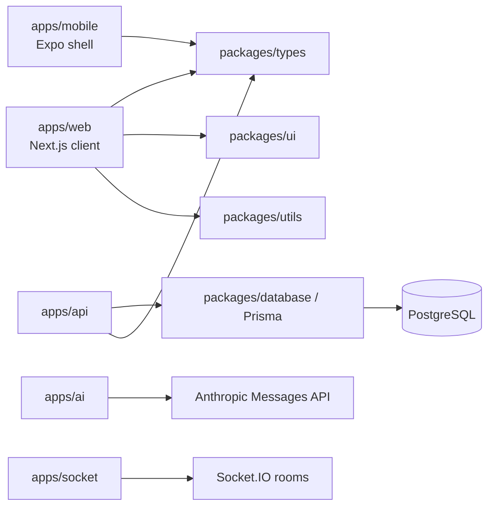

# Devpulse Project Blueprint

> A code-oriented guide to the product flow, architecture, UI, theme system, data lifecycle, and current implementation boundaries. This describes the repository as it exists today; it is not a claim that every screen is backed by production services.

## 1. Product at a glance

Devpulse is a developer workspace prototype organized as a pnpm/Turborepo monorepo. Its main product surface is a Next.js web client that presents repository management, cloud-workspace concepts, a code workbench, deployments, AI assistance, collaboration, infrastructure controls, billing, and appearance settings.

The intended user story is: authenticate or enter the demo → choose an appearance → select/create a project → start or open a workspace → edit and preview code → use AI and collaboration tools → inspect activity and deployments → manage settings and plans. Navigation is available throughout the shell, so this is a guided product journey rather than a strictly enforced wizard.

The current implementation mixes three levels of behavior:

1. **Implemented in the browser:** screens, interactions, theme selection, editor/session state, sample datasets, dialogs, and local persistence.
2. **Service seams or partial connections:** selected authentication and CRUD calls in `AppContext`, AI chat streaming, and basic Socket.IO presence.
3. **Preview-only concepts:** much of repository/workspace/deployment persistence, terminal execution, inline completion, Huddle/WebRTC, billing, API sandbox data, and cloud allocation.

## 2. Repository and package map

```text
apps/
  web/       Next.js 14 + React 18 product UI; primary application
  api/       Express API process; currently health/readiness endpoints only
  ai/        Express AI process; Anthropic streamed chat endpoint
  socket/    Socket.IO process; workspace room and presence events
  mobile/    Expo shell; currently a branded placeholder screen
packages/
  config/    shared TypeScript, ESLint, and Tailwind configuration
  database/  Prisma client, PostgreSQL schema, seed entry point
  types/     shared API/domain TypeScript types
  ui/        small shared React button primitive package
  utils/     shared utility exports (including class composition)
```

The workspace is declared by `pnpm-workspace.yaml` (`apps/*`, `packages/*`). Turbo task dependencies and outputs are in `turbo.json`; root scripts delegate through `scripts/turbo.mjs`. Runtime requirements are Node.js 20.10+ and pnpm 9.15+.

### Main dependency relationships



Redis and MinIO are provisioned in `docker-compose.yml`, but the current service source does not use them. Stripe, OAuth, email, and AWS/S3 variables are declared in `.env.example`; declaration/configuration is not evidence those workflows are implemented.

## 3. Web application boot and navigation

### Boot sequence

1. `apps/web/app/layout.tsx` imports global CSS and xterm styles, sets metadata, and injects a `beforeInteractive` script. That script reads saved theme data and applies CSS variables before hydration to reduce a theme flash.
2. `apps/web/app/page.tsx` mounts `AppProvider`, then `HuddleProvider`, the render error boundary, route content, global overlays, and the friendly alert/confirm host.
3. `AppProvider` initializes the page, user, theme, data, and editor state from browser storage/demo defaults. It marks client storage hydration complete before the route content renders.
4. The selected component is rendered conditionally in `MainAppContent`. Screens are dynamically imported with SSR disabled. The shell is skipped for the login and theme-selection screens; other pages render inside `AppShell`.
5. `AppShell` owns the persistent navigation/sidebar, top bar, mobile navigation, account/settings menus, command palette entry points, quick tour, and shared shell layout.

### Routing model

There are no per-screen Next.js route files. `PageType` and `setPage()` in `apps/web/app/context/AppContext.tsx` are the in-app router; the page choice is persisted in `devpulse_active_page`. `page.tsx` switches over that state. Links, command-palette entries, keyboard shortcuts, and cross-screen calls all change the same page state.

The saved-page reader validates against the current page union and maps the legacy `remote-control` selection to `chat`. A fresh/unset page defaults to `api-sandbox`. Login completion takes the user to `theme` until theme selection is marked complete, then to `workspaces`.

### Screen inventory

| Page id | Component | Purpose and principal flow |
| --- | --- | --- |
| `login` | `LoginPage.tsx` | Welcome/auth UI, dev/demo entry, login and color-mode affordances. The context attempts `/v1/me` and `/v1/auth/logout`; the current API server does not implement these routes. |
| `theme` | `ThemePalettePage.tsx` | Select, preview, customize, favorite, search, and import VS Code themes; proceed to workspaces/editor. |
| `repositories` | `RepositoriesPage.tsx` | Browse/search/filter/star project cards; create project dialog; launch toward workspaces; navigate to release details. |
| `workspaces` | `WorkspacesPage.tsx` | Inspect devbox cards and state; start/stop/remove; open the editor or return to projects. |
| `activity` | `ActivityPage.tsx` | Filter and inspect activity events, charts and detail dialog; some events link to relevant screens. |
| `deployments` | `DeploymentsPage.tsx` | Review release targets, domains, branches, commits and pipeline state; trigger/rerun release actions. |
| `chat` | `TeamChatPage.tsx` | Team/channel conversation UI and channel details. Message state is screen-level prototype data. |
| `editor` | `EditorWorkbench.tsx` | IDE-like project tree, tabs, Monaco editor, terminal, local files, search, settings and AI drawer. |
| `remote-control` | `RemoteControlPage.tsx` | Pulse Pilot remote-help controls; the stored route is normalized to chat in current startup logic. |
| `ai-studio` | `FullScreenAiPage.tsx` | Full-screen assistant conversation, model and generation controls; calls the AI chat service. |
| `pricing` | `PricingPage.tsx` | Plan cards and billing-cycle presentation; navigates to custom plan or payment setup. |
| `custom-plan` | `CustomPlanPage.tsx` | Configure a proposed plan from pricing. |
| `cloud-core` | `CloudCoreDashboard.tsx` | Cloud capacity/usage and allocation-oriented UI. |
| `api-sandbox` | `ApiSandboxPage.tsx` | API request/scenario explorer with snapshots and record detail; data is a local simulation. |
| `settings` | `SiteSettingsPage.tsx` | Appearance, account, app preferences, and billing/settings links. |
| `payment-methods` | `PaymentMethodsPage.tsx` | Payment method management presentation. |

Important overlays include `CommandPalette`, `ShortcutsDialog`, `OnboardingTour`, toast host, friendly alert/confirm dialogs, repository creation, activity detail, API snapshots, cloud allocation, editor Quick Open/find/replace/menus/settings, and AI editor drawer. See `PROJECT_MAP.md` for the detailed overlay reachability and component line inventory.

## 4. Shared state and data lifecycle

`AppContext.tsx` is the central client state contract. It defines the page union and domain models (`UserProfile`, `Repository`, `WorkspaceDevbox`, `Deployment`, `ActivityEvent`, `EnvVariable`, `EditorFile`, toast/log types), owns most globally shared state, and exposes action functions to screens.

### State domains

- **Identity and route:** user profile/authenticated flag, login/logout, selected page, command palette/shortcut visibility.
- **Appearance:** active theme, imported themes, color mode, match-system preference.
- **Project operations:** repository list/search/filter and add/delete/star actions; workspaces and their lifecycle actions.
- **Release and environment:** deployments, activity feed, environment variables, deploy-on-push and ephemeral-PR preferences, logs.
- **Editor:** project session, file/folder tree, open tabs, active file, dirty/saved contents, language, file CRUD and local-file loading.
- **Product feedback:** toast notifications, loading flags, guided-tour state and friendly modal events.

Most presentation data starts with in-source demo arrays and browser state. A `apiJson()` helper targets `NEXT_PUBLIC_API_URL` (default `http://localhost:4000`). On initialization, the context requests `/v1/repositories`, `/v1/devboxes`, `/v1/deployments`, and `/v1/environment-variables`; failed requests are swallowed and the loading indicator is cleared, leaving the demo/local state usable. Mutation methods also call API endpoints for some operations, so with the current API implementation these requests fail unless an external API implementation is supplied.

### Browser persistence

| Browser storage key | Persisted concern |
| --- | --- |
| `devpulse_active_page` | Selected in-app screen |
| `devpulse_user_session`, `devpulse_logged_out` | Demo/user profile and explicit local sign-out state |
| `devpulse_theme`, `devpulse_imported_themes`, theme-selected flag | Active theme, imported presets, onboarding completion |
| `devpulse_color_mode`, `devpulse_match_system_theme` | Appearance mode and system preference |
| `devpulse_workspaces`, `devpulse_activity_events` | Workspace/activity state snapshots |
| `devpulse_editor_session` | Open editor project, tree, tabs, contents and saved contents |
| `devpulse_ui_preferences`, `devpulse_billing_method`, `devpulse_activity_timer` | UI density/motion, billing selection and activity timer preferences |
| `devpulse-editor-panels`, `devpulse-ide-layout`, `devpulse-editor-hint-dismissed`, `devpulse-workbench-sidebar-open`, `devpulse-terminal-layout` | Editor layout/panel preferences |

The editor also uses IndexedDB database `devpulse-editor-handles` / object store `handles` for browser file-system handles. Explicit local file/folder import uses the browser File System Access API. These browser stores are local to that browser profile and are not account-wide persistence.

## 5. End-to-end product flows

### Onboarding and returning user

The demo profile and default route allow the UI to open without a real login round trip. Login actions set local user state and route to theme selection or workspaces depending on a local completion flag. Separately, startup asks `/v1/me` with credentials; if a compatible auth server responds with a user, it updates the displayed profile. Logout attempts `/v1/auth/logout`, clears local user storage, marks a local logged-out flag, and routes to login. Those API endpoints are not present in `apps/api/src/index.ts` today.

### Project to workspace to editor

The repository list is the project-selection surface. Creating/starring/deleting can invoke context actions; repository cards link into workspace/deployment routes. Workspaces show devbox-like status, capacity and URL data and offer lifecycle controls. The editor loads a starter/local project snapshot, manages files and dirty state in the browser, and saves through `saveEditorPreview()` which currently acknowledges a preview save. A project can also import user-selected local files/folders directly from the browser.

### Code and AI

`EditorWorkbench.tsx` dynamically loads Monaco on the client, registers theme data, manages explorer/tabs/breadcrumbs/search/replace/split panes/status, and can host an xterm terminal panel. `TerminalPanel.tsx` applies current theme terminal tokens; the terminal reconnect/run adapters in `editorMocks.ts` remain preview implementations. Inline completion in `aiCompletion.ts` returns a sample completion for an explicit `// ai:` or `# ai:` marker; `languageServer.ts` filters hardcoded completion examples.

The full-screen AI page posts a conversation to the AI service and consumes server-sent events. The AI service exposes `POST /v1/chat`, returns `503` without `ANTHROPIC_API_KEY`, then streams activity/token/done/error events from Anthropic. The page exposes UI model/generation choices; the service itself currently uses `ANTHROPIC_MODEL` (default `claude-3-5-sonnet-latest`) and max 1024 tokens. The editor's assistant preview adapter is not necessarily the same live streaming path. Applying AI-generated editor diffs is currently client-side state behavior.

### Collaboration

`HuddleProvider` wraps a small in-memory singleton `huddleService`. It models active state, mute/camera flags, screen-share ownership and edit permission, and emits local events/toasts. The service comments mark WebRTC and realtime edit sync as future work. The Socket.IO process separately supports `workspace:join`, `workspace:leave`, and `presence:update` → `presence:changed` within a workspace room. The current frontend does not wire Huddle to WebRTC or editor synchronization, and chat is not backed by a message API.

### Release, activity, settings and billing

Deployment, activity, API sandbox, cloud-core and pricing screens provide product workflows and seeded data. Context-level release/environment actions can be routed through the API adapter, but the current Express API has no corresponding resource routes. The Prisma schema includes some user/workspace/project/file/revision/channel/message concepts, but no deployment, devbox, repository, environment-variable, subscription or payment models. Billing/payment screens are therefore presentation flows, not an implemented Stripe lifecycle.

## 6. Visual design and theme system

### Design direction

The web product uses a dense developer-tool layout: persistent dark shell, compact technical typography, high-contrast panels, subtle borders, code-oriented monospace areas, status accents, and IDE-inspired interaction patterns. Shared spacing, radius, type, shadow, z-index and motion tokens live in `apps/web/app/styles/design-tokens.css`; global CSS and semantic component classes are in `apps/web/app/globals.css`. Tailwind is configured at the app/workspace level. `components/ide/Primitives.tsx` provides local reusable IDE controls (buttons, icon buttons, badges, inputs, panels, tabs, resizers, modal, dropdown, switch). A separate `packages/ui` package exports a button, but much of the application uses the local IDE primitives and screen-specific JSX.

### Theme model and application path

- `context/themeModel.ts` defines `ThemeConfig`, semantic UI tokens, syntax tokens, terminal ANSI tokens, optional Monaco data, defaults, preset IDs and normalization helpers.
- `context/themeLibrary.ts` defines/lazily supplies the theme library, including One Dark Pro, Dracula, GitHub Dark/Light, Material Palenight, Night Owl, Monokai, Tokyo Night, Ayu Mirage/Light, and Cobalt2. Cyber Mint is the default preset.
- `components/ThemePalettePage.tsx` is the theme library UI: search/groups, favorites/recent, preview, accent edits, mode switch, and VS Code JSON import.
- `editor/vscodeThemeConverter.ts` converts imported VS Code color/token rules into the internal theme/Monaco shape.
- `AppContext.setTheme()` resolves the theme, stores it in localStorage, marks onboarding complete, and applies CSS variables to the document. The initial script in `layout.tsx` mirrors enough of that process before hydration.
- Theme application sets document attributes (`data-theme-mode`, `data-theme-type`, body `data-theme`), `color-scheme`, `--ide-color-*`, `--ide-syntax-*`, `--ide-terminal-*`, legacy CSS variables and UI font stack. Monaco receives a registered `devpulse-<theme-id>` theme; xterm reads terminal tokens in `TerminalPanel.tsx`.
- Appearance is also reachable from login, settings, command palette, the shell theme shortcut, and the dedicated palette page.

The project has both semantic theme tokens and legacy/screen-specific styling. `PROJECT_MAP.md` has a color audit identifying remaining literals; in particular, hard-coded light text, surfaces, brand CTA colors and chart/status series may not adapt perfectly in light mode. Treat the token system as the intended direction, not proof that every pixel is fully theme-neutral.

## 7. Services, persistence and current reality

| Process / package | Current code behavior | Important boundary |
| --- | --- | --- |
| Web (`apps/web`) | UI, context state, localStorage/IndexedDB, browser File System Access API, AI fetch, attempted API fetches | Most workflows remain browser/demo state; no server-side web auth/session implementation in this repo. |
| API (`apps/api`) | Express + Helmet + CORS allowlist + JSON parser + Pino; `GET /health`, `GET /ready` | No `/v1/*` auth, repository, devbox, deployment or environment-variable handlers currently defined. |
| AI (`apps/ai`) | `GET /health`, `POST /v1/chat`, Anthropic streamed response | Requires API key; no auth/rate limiting/session ownership visible in current endpoint. |
| Socket (`apps/socket`) | Health check, Socket.IO connection, room join/leave and relayed presence | No persistence or richer collaboration protocol; Redis URL is configured in compose but not used in the source shown. |
| Database (`packages/database`) | Prisma client and PostgreSQL schema/seed | Schema has users, workspaces/members, projects/files/revisions, channels/messages. The main API does not yet call the database. |
| Mobile (`apps/mobile`) | Expo starter UI and environment wiring in compose | No parity with web features; currently only logo/tagline/status bar. |

`packages/types` currently contains shared plan/role/workspace summary/API error types. The schema and types are foundations, not evidence of integrated end-to-end workflows.

## 8. Operational and developer setup

See `DEVELOPMENT.md` for the full commands. The usual local path is:

```bash
corepack enable
pnpm install
copy .env.example .env
docker compose up -d postgres redis minio
pnpm migrate
pnpm seed
pnpm dev
```

The web app is at `http://localhost:3000`; API at `:4000`; Socket.IO at `:4001`; AI service at `:4002`; PostgreSQL at `:5432`; Redis at `:6379`; MinIO console at `:9001`. `docker-compose.yml` can also run all app containers. Environment variable names and intended integrations are listed in `.env.example`.

## 9. Main implementation seams and recommended build order

1. **Define the domain/API contract.** The client already expects `/v1/me`, auth logout, repositories, devboxes, deployments and environment variables; formalize request/response schemas and error behavior in shared types before adding client workarounds.
2. **Implement auth and ownership.** Add real identity/session routes, secure cookie/token lifecycle, workspace membership checks, and replace the implicit demo user in production mode.
3. **Connect persistence.** Build API repositories around Prisma and migrate client CRUD from local mock mutation to API-backed data with clear loading/error/empty states. Extend schema for missing domain concepts only as requirements are agreed.
4. **Make workspaces executable.** Define devbox provisioning/lifecycle contracts and runtime isolation, then connect UI status and logs to real process events.
5. **Complete editor persistence and execution.** Persist file contents/revisions, implement save conflict/version behavior, and replace preview run/terminal/completion adapters with controlled services.
6. **Harden AI.** Validate conversation payloads, enforce auth/quotas, cancellation and provider error handling, and define structured patch contracts before applying code changes.
7. **Complete collaboration.** Add authenticated Socket.IO events, durable chat APIs, presence cleanup, and WebRTC/signaling/editor-sync only if required by the product scope.
8. **Wire releases and billing.** Implement deployment orchestration and Stripe/webhook-backed billing behind explicit server-side contracts; presentation-only flows should remain labeled as such until then.
9. **Finish product quality.** Audit theme literals/light mode, accessibility, mobile parity, and integration tests after the underlying contracts stabilize.

## 10. Source map for deeper reading

- Product map and page/overlay inventory: `PROJECT_MAP.md`
- User-facing overview and quick start: `README.md`
- Development operations: `DEVELOPMENT.md`
- Web boot/routing: `apps/web/app/layout.tsx`, `apps/web/app/page.tsx`
- Shared UI state/actions: `apps/web/app/context/AppContext.tsx`
- Shell and navigation: `apps/web/app/components/AppShell.tsx`
- Theme model, library, conversion: `apps/web/app/context/themeModel.ts`, `themeLibrary.ts`, `apps/web/app/editor/vscodeThemeConverter.ts`
- Editor and terminal: `apps/web/app/components/EditorWorkbench.tsx`, `TerminalPanel.tsx`, `apps/web/app/services/editorMocks.ts`
- AI and completion seams: `apps/ai/src/index.ts`, `apps/web/app/components/FullScreenAiPage.tsx`, `apps/web/app/services/aiCompletion.ts`, `languageServer.ts`
- Collaboration seams: `apps/socket/src/index.ts`, `apps/web/app/context/HuddleContext.tsx`, `apps/web/app/services/huddle.ts`
- Persistence model: `packages/database/prisma/schema.prisma`
- Local infrastructure and env: `docker-compose.yml`, `.env.example`
