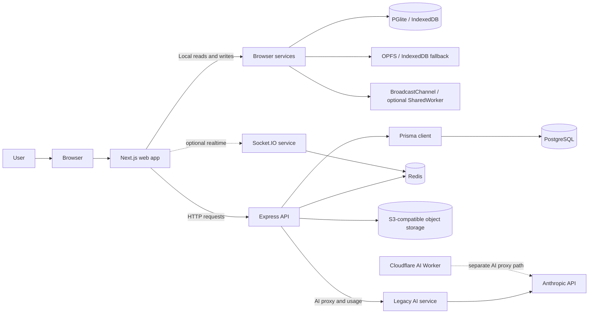

# Devpulse Web Application Flow and Blockers

## Purpose and current state

This guide maps the web application from browser entry through frontend services,
backend APIs, and persistence, and records the known flow blockers.

**Current state: hybrid, not browser-only.** The web app contains browser-local
services (PGlite, IndexedDB, and file storage), while important flows still use
the Express API, PostgreSQL/Prisma, Redis, Docker, and Socket.IO. These stores
and services are not one automatically synchronized system. A screen being
present in the UI does not by itself mean its production integration is complete.

The findings below are based on source and repository documentation. They are
not a claim that every service or integration was run and verified. See
[Validation limits](#validation-limits).

## System overview

| Layer | Main implementation | Role in the current flow |
|---|---|---|
| Frontend | `apps/web/app/`, `apps/web/src/` | Next.js UI, app state, browser services, and HTTP clients |
| Backend | `apps/api/src/` | Authentication, project/file APIs, AI proxy, execution, and product endpoints |
| Realtime | `apps/socket/src/` and browser realtime helpers | Socket.IO service for cross-client events; browser channels for same-origin contexts |
| Server database | `packages/database/prisma/` | Prisma schema and PostgreSQL persistence used by the API |
| Browser database | `apps/web/src/lib/db/` and `apps/web/src/lib/db.ts` | PGlite/Drizzle persistence in the browser's origin |
| Auxiliary services | `apps/ai/`, `apps/ai-worker/` | Legacy AI service and a separate edge-worker proxy implementation |

## End-to-end flows

### 1. Browser startup and screen navigation

1. The browser requests the Next.js app. The root route mounts the app shell and
   `AppProvider`.
2. The root screen switches between login, theme selection, and product screens
   using frontend state. Most screens are selected within the root page rather
   than through a distinct URL route.
3. Browser-dependent features initialize their browser services when their
   hooks/components request them. That may open PGlite, apply browser SQL
   migrations, seed demo data, initialize state/file storage, and set up
   same-origin realtime.
4. Features that still use server data separately call the API and handle their
   own loading, error, and fallback states.

The root UI and feature service initialization are separate concerns; a
successful web shell load does not prove that the API or all browser services
are ready. See [Frontend implementation](apps/web/app/page.tsx),
[AppContext](apps/web/app/context/AppContext.tsx), and
[browser services](apps/web/src/lib/services.ts).

### 2. Authentication and session

**Production provider/email path**

1. The user starts GitHub/Google OAuth or requests a magic link from the web UI.
2. The browser calls the API auth routes. OAuth uses a provider redirect and
   callback; magic-link email uses Resend in production.
3. The API validates the flow, creates or resolves the user and workspace,
   issues an access token, and sets an HTTP-only refresh-token cookie.
4. The web app keeps the access token only in the shared in-memory auth store.
   Authenticated requests include credentials; a 401 triggers one refresh and
   retry. A failed retry clears the token and returns the UI to login.
5. On startup, the app refreshes the session and requests `/v1/me`. It restores
   a saved local profile only when the API is unreachable and data mode is
   explicitly `local`.

**Development path**

Development login calls the API's development-only auth route, which returns a
signed access token and sets the refresh cookie. The browser uses the returned
server user as its profile; it does not mint a client token. The route is not
registered in production.

Magic-link verification sets the returned API access token before loading the
canonical profile from `/v1/me`. The app's `login()` action only updates profile
state and does not issue or replace credentials. Logout clears the in-memory
token and requests the API logout route to expire its cookies.

Relevant code: [login UI](apps/web/app/components/LoginPage.tsx),
[auth API](apps/api/src/routes/auth.ts),
[JWT helpers](apps/api/src/lib/jwt.ts), and
[AppContext auth actions](apps/web/app/context/AppContext.tsx).

### 3. Repositories, workspaces, and product screens

1. The user navigates through the app shell to repositories, workspaces,
   deployments, chat, AI Studio, or other screens.
2. Some screen data comes from browser-local PGlite/demo state; other data is
   requested from the Express API.
3. Several actions have local demo/simulation behavior when real infrastructure
   is not connected. For example, the new-release action creates a simulated
   deployment rather than executing a production deployment pipeline.

These are not yet a single consistent server-backed data flow. The UI's
repositories, workspace, deployment, and other data ownership needs to be
considered feature-by-feature. Relevant implementation includes
[AppContext](apps/web/app/context/AppContext.tsx) and
[API routes](apps/api/src/index.ts).

| User area | Current data/action path | Current limitation |
|---|---|---|
| Login and theme setup | API auth plus app/session state; theme selection is frontend state | Demo login and production API identity are not interchangeable |
| Repositories | Browser-local database and app state, with API-backed product data in some paths | Local and server records do not automatically synchronize |
| Workspaces/devboxes | API calls with demo/local fallback behavior | A persisted devbox record is not proof that a real compute workspace was provisioned |
| Editor | Browser-local and API-backed project/file paths | Persistence depends on which project/file path was selected |
| Deployments/environment | API-backed data in some flows; release action may be simulated | UI state does not guarantee a real release pipeline or billing integration |
| Team Chat | Browser database and same-origin broadcasts; optional Socket.IO path | Local messages and server collaboration are separate paths |
| AI Studio | Separate client endpoint from editor AI | Endpoint mismatch can prevent requests from reaching the implemented AI route |
| Remote Control | Optional Socket.IO collaboration flow | Current client uses a demo workspace identity rather than the selected workspace |
| Plans and other product screens | UI state/presentation | Subscription/payment behavior needs a real billing integration |

### 4. Editor and file persistence

1. The editor selects or discovers a project and obtains file metadata/content.
   Depending on the path, it can use a browser-local project or call project
   and file endpoints in the API.
2. Monaco edits the active file. Local/imported/new files can remain browser
   state; API-backed files are saved through the server.
3. The API validates the request, persists the file and version/revision using
   Prisma, and returns the saved result. The editor handles loading, save
   errors/conflicts, and session restoration.
4. Browser-backed saves write to PGlite and browser file storage instead; they
   do not automatically become PostgreSQL records.

Relevant implementation: [EditorWorkbench](apps/web/app/components/EditorWorkbench.tsx),
[editor data flow](apps/web/app/context/AppContext.tsx),
[API file routes](apps/api/src/index.ts),
[browser database](apps/web/src/lib/db.ts), and
[Prisma schema](packages/database/prisma/schema.prisma).

### 5. Code execution

1. The editor sends source and execution options to the API.
2. The API starts the execution path, which uses Docker for an isolated
   short-lived runtime and returns output/status to the web UI.
3. This flow therefore depends on the API and execution infrastructure; local
   PGlite or a working editor screen alone cannot execute server-side code.

Relevant implementation: execution handlers in
[apps/api/src/index.ts](apps/api/src/index.ts). Runtime availability and
authorization coverage must be verified before exposing this flow.

### 6. AI chat and apply-to-editor

**Editor AI path**

1. The editor sends chat input and optional file/selection context to the API
   streaming endpoint.
2. The API applies its authentication/usage/resource checks, forwards the
   request to the legacy AI service, and relays server-sent events.
3. The AI service calls Anthropic using its server-side key and streams chunks
   back through the API.
4. The editor renders the response. Apply actions preview the proposed change
   before updating/saving the editor file.

**Separate edge path**

The Cloudflare Worker is a separate AI proxy implementation. Its existence
does not mean the editor is currently using that Worker; the main editor path
uses the API-to-AI-service route.

**AI Studio**

AI Studio has a separate client request path and must be checked independently;
its current endpoint does not match the API route used by the editor.

Relevant implementation: [EditorWorkbench](apps/web/app/components/EditorWorkbench.tsx),
[FullScreenAiPage](apps/web/app/components/FullScreenAiPage.tsx),
[API AI handlers](apps/api/src/index.ts),
[legacy AI service](apps/ai/src/index.ts), and
[AI Worker](apps/ai-worker/src/index.ts).

### 7. Team chat and realtime collaboration

There are two distinct realtime/data paths:

- Team Chat can read/write messages in browser-local storage and broadcast
  same-origin changes using `BroadcastChannel`.
- The optional Socket.IO client connects to the separate realtime service for
  workspace events such as presence, typing, cursor/selection, and code changes.
  That server uses Redis for cross-client state.

Browser-local events do not automatically synchronize with Socket.IO or
PostgreSQL. Remote Control also has a demo workspace identity in its current
client flow, so it should not be treated as connected to whichever workspace
the user selected.

Relevant implementation: [TeamChatPage](apps/web/app/components/TeamChatPage.tsx),
[browser realtime](apps/web/src/lib/realtime.ts),
[Socket.IO client](apps/web/src/lib/socket-client.ts),
[Socket.IO server](apps/socket/src/index.ts), and
[RemoteControlPage](apps/web/app/components/RemoteControlPage.tsx).

### 8. Database and storage paths

| Data path | Store | Consumers | Important boundary |
|---|---|---|---|
| Server-side account, workspace, project, file/revision, chat, AI usage, and related records | PostgreSQL through Prisma | Express API | Requires reachable PostgreSQL and applicable Prisma migrations |
| Rate limits, ephemeral/session/realtime state | Redis | API and Socket.IO | Not a durable replacement for PostgreSQL |
| Larger artifacts/object storage | S3-compatible service such as MinIO | API | Requires storage configuration and a reachable bucket |
| Browser-local relational data | PGlite with IndexedDB persistence and Drizzle | Web browser services | Scoped to browser profile/origin; not shared across devices or server clients |
| Browser-local state and file bytes | IndexedDB and OPFS, with fallback behavior | Web browser services | Local to the origin/profile; not equivalent to server backup or collaboration |

The browser schema and Prisma schema are separate implementations. They do
not share a migration history, automatically replicate data, or have identical
feature coverage. The browser schema does not currently model every server-side
feature.

## Known blockers and issues

The entries below distinguish **confirmed code/documentation gaps** from
**external setup or runtime verification requirements**. “Blocker” means the
affected flow is incomplete or cannot be relied on in the stated situation; it
does not imply that every deployment is currently failing.

### Frontend and authentication blockers

| Issue | Impact | Evidence / next step |
|---|---|---|
| Browser-local and API-backed data paths are mixed | A browser-local write is not persisted to PostgreSQL and will not appear automatically on another device or API consumer. | Choose the source of truth per feature and implement explicit migration/synchronization if required. See [AppContext](apps/web/app/context/AppContext.tsx) and [browser services](apps/web/src/lib/services.ts). |
| Client-generated and persisted access tokens could override API credentials | **Resolved in the current worktree.** Access tokens now live in one in-memory store, and authenticated requests refresh/retry once before expiring the session. | Vitest covers in-memory storage, verified-token reuse, refresh/retry, and logout; Playwright covers development login to an authorized project request. See [auth store](apps/web/src/lib/auth-store.ts) and [auth tests](apps/web/src/lib/auth-store.test.ts). |
| Development and magic-link login could replace valid API credentials | **Resolved in the current worktree.** Development login consumes the API-issued JWT; magic-link verification installs the returned token before `/v1/me`; profile login does not mint tokens. | See [login UI](apps/web/app/components/LoginPage.tsx), [verification UI](apps/web/app/auth/verify/page.tsx), and [API auth routes](apps/api/src/routes/auth.ts). |
| AI Studio endpoint differs from the editor/API endpoint | AI Studio requests do not follow the implemented `/v1/ai/chat` API route and may fail instead of reaching the configured AI service. | Align AI Studio with the intended API or Worker route and test streaming end-to-end. See [FullScreenAiPage](apps/web/app/components/FullScreenAiPage.tsx) and [API AI handlers](apps/api/src/index.ts). |
| Some UI actions are simulations or placeholders | A successful UI state can be mistaken for real deployment/provisioning/billing behavior. | Label demo behavior clearly and connect actions to provisioner/provider APIs before claiming production support. See [AppContext](apps/web/app/context/AppContext.tsx) and the unavailable feature handling in [page.tsx](apps/web/app/page.tsx). |
| Root navigation is mostly frontend state, not deep-linked routes | Refreshing or sharing a URL may not restore the selected product screen. | Define URL routes/deep-link behavior if direct navigation and refresh restoration are required. See [page.tsx](apps/web/app/page.tsx). |

### Backend and service blockers

| Issue | Impact | Evidence / next step |
|---|---|---|
| API requires server infrastructure/configuration | API startup depends on database connectivity and configured JWT material; OAuth/email/AI features additionally need provider configuration. | Provide and verify environment values, database, Redis/storage where needed, and signing keys before starting the API. See [API startup](apps/api/src/index.ts) and [environment validation](apps/api/src/lib/env.ts). |
| Authorization is not consistently enforced across all API routes | Source inspection found project/file reads or creation and code execution handlers without an apparent user/membership check; review and close these gaps before untrusted deployment. | Apply a consistent authentication and workspace/project authorization policy, especially for execution and data access. See route handlers in [apps/api/src/index.ts]. |
| Socket.IO accepts workspace identity without apparent credential verification | Clients can identify a workspace/user at connection/join time without the service visibly establishing membership. This makes the realtime flow unsuitable to rely on for protected collaboration until verified and fixed. | Authenticate the socket handshake and authorize every workspace join/event. See [Socket.IO server](apps/socket/src/index.ts) and [Socket.IO client](apps/web/src/lib/socket-client.ts). |
| Legacy AI service route is separate from the Worker | The standalone AI service has no visible request-auth middleware in the inspected route path, while the Worker has a separate validation path. The current editor flow is through the API and legacy AI service. | Restrict service-to-service access or route production requests through a consistently authenticated proxy. See [legacy AI service](apps/ai/src/index.ts), [API AI handlers](apps/api/src/index.ts), and [AI Worker](apps/ai-worker/src/index.ts). |
| Production integrations need owner-provided secrets and configuration | OAuth, magic-link email, and AI provider calls cannot complete against real providers without their credentials, registered callback URLs, sender setup, and account access. | Configure secrets in the deployment secret store and verify each provider flow; do not put secret keys in browser-exposed variables. |
| Code execution and real deployments need operational infrastructure | Editor execution requires the API and Docker runtime. Real devbox provisioning and release pipelines require infrastructure beyond UI state and database records. | Deploy and health-check the required runners/provisioners/pipelines; do not treat stored records or simulated success as execution. |

### Database and persistence blockers

| Issue | Impact | Evidence / next step |
|---|---|---|
| Duplicate project-column migrations | **Resolved in the current worktree.** The two same-timestamp migrations were replaced with one uniquely timestamped migration that adds each `Project` column once using `IF NOT EXISTS`. Fresh deploy, migration status, schema diff, and Prisma validation passed against throwaway PostgreSQL. | Retained migration: [20260928120100_add_project_template_and_privacy](packages/database/prisma/migrations/20260928120100_add_project_template_and_privacy/migration.sql). PR verification is in [.github/workflows/db.yml](.github/workflows/db.yml). |
| OAuth primary-key constraint name differed from Prisma schema | **Resolved in the current worktree.** The schema diff on the fresh database detected the old constraint name after the table rename; a guarded forward migration now aligns it without rewriting prior migration history. | See [20261030000000_rename_oauth_accounts_primary_key](packages/database/prisma/migrations/20261030000000_rename_oauth_accounts_primary_key/migration.sql). |
| Prisma and browser schema/migrations are independent | Migration success in one store does not migrate or synchronize the other. The browser schema also lacks some server-side feature tables. | Establish the authoritative schema for each supported mode and document/implement any required import or sync contract. See [Prisma schema](packages/database/prisma/schema.prisma), [browser schema](apps/web/src/lib/db/schema.ts), and [browser migrations](apps/web/src/lib/db.ts). |
| Browser persistence is origin/profile-local | Data is not automatically backed up, shared between users, or available on another device. Browser storage can also be cleared by the user/browser. | Provide export/backup and/or a server sync path if data durability and multi-device access are product requirements. |
| Full database-backed feature integration is not established by migration checks | The new CI job verifies fresh migration deployment and schema parity, but does not exercise every API persistence flow. | Add feature-level database integration coverage where required; keep [.github/workflows/db.yml](.github/workflows/db.yml) as the migration/schema check. |

### Integration, operations, and verification blockers

- **Hybrid runtime requirements:** local API-backed workflows depend on the API;
  database-backed API workflows depend on PostgreSQL; other flows depend on
  Redis, MinIO, Docker, Socket.IO, or AI as applicable. A web-only startup does
  not imply these dependencies are available.
- **Conflicting setup paths:** repository docs describe both browser-local
  development and the legacy Docker/service stack. Use the instructions for the
  specific flow being tested; keep the root scripts, setup docs, and deployment
  configuration aligned.
- **Email/OAuth/AI are externally gated:** real delivery/provider exchanges
  require valid secrets and provider-side setup. Demo/dev responses are not
  proof of production integration.
- **End-to-end integration remains unverified here:** the database migrations
  were applied successfully to a fresh throwaway PostgreSQL database, but
  external providers and browser/API E2E flows were not exercised. Historical
  E2E notes describe environment blockers; re-run the current test suite when
  the local services and browser runtime are ready. See
  [Playwright editor report](PLAYWRIGHT_EDITOR_E2E_REPORT.md) and
  [troubleshooting guide](TROUBLESHOOTING.md).

## Suggested order to unblock the end-to-end flow

1. Keep the fresh-database Prisma migration and schema-diff checks green in CI.
2. Decide which features are server-backed versus browser-local; define the
   data ownership/synchronization contract and consolidate browser service
   initialization where appropriate.
3. Align AI Studio with the actual authenticated streaming endpoint and choose
   one production AI proxy path.
4. Add and test consistent API and Socket.IO authentication/authorization,
   including execution and workspace access.
5. Clearly separate implemented integrations from demo/simulated screens;
   complete provisioning, deployment, billing, and collaboration integrations
   needed for the intended product scope.
6. Run migrations, API/web tests, and Playwright E2E against a fully configured
   local stack, then separately verify OAuth, email, AI, and deployment
   integrations in a safe staging environment.

## Validation limits

This guide is based on source inspection. The migration fixes were tested by
deploying all migrations to a fresh throwaway PostgreSQL 15 database, checking
migration status, confirming `prisma migrate diff --exit-code` reported no
differences, and validating the Prisma schema. The web/API test suites and
external provider flows were not run for this database change. Findings that
depend on runtime configuration or infrastructure remain setup or verification
requirements, not assertions that every deployment is currently down.

## Related documentation

- [Project blueprint](PROJECT_BLUEPRINT.md) — architecture and browser/legacy transition.
- [Project handoff](PROJECT_HANDOFF.md) — historical setup, implementation status, and test notes.
- [Development guide](DEVELOPMENT.md) — local workflows and configuration.
- [Integration status](INTEGRATION_STATUS.md) — email and AI integration setup/status.
- [Troubleshooting guide](TROUBLESHOOTING.md) — local infrastructure recovery.
